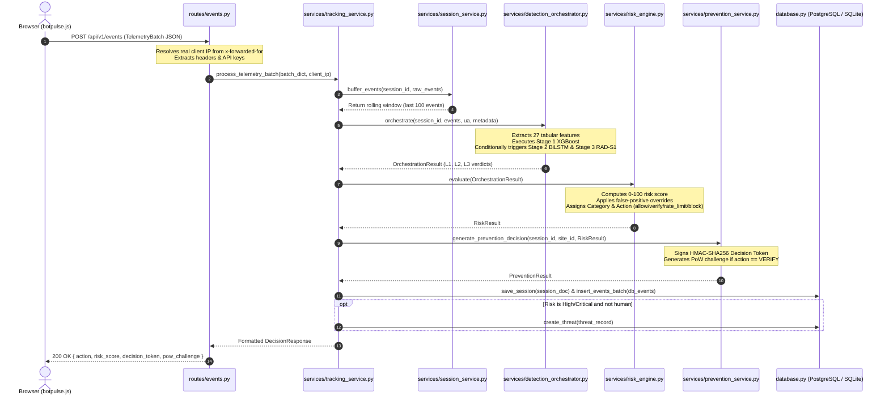
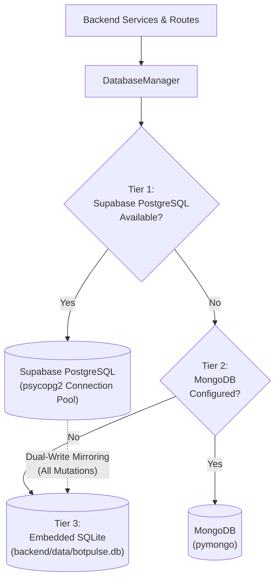
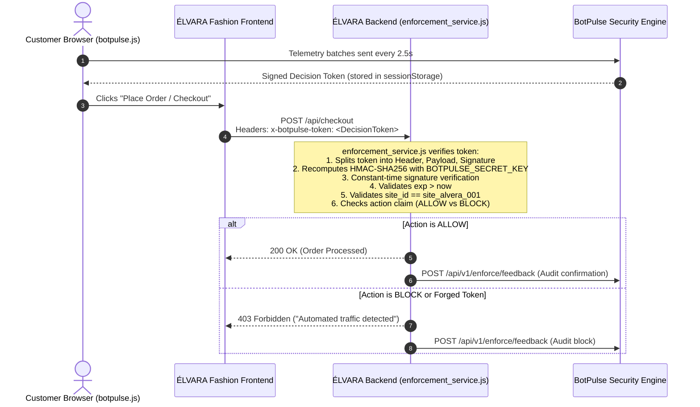
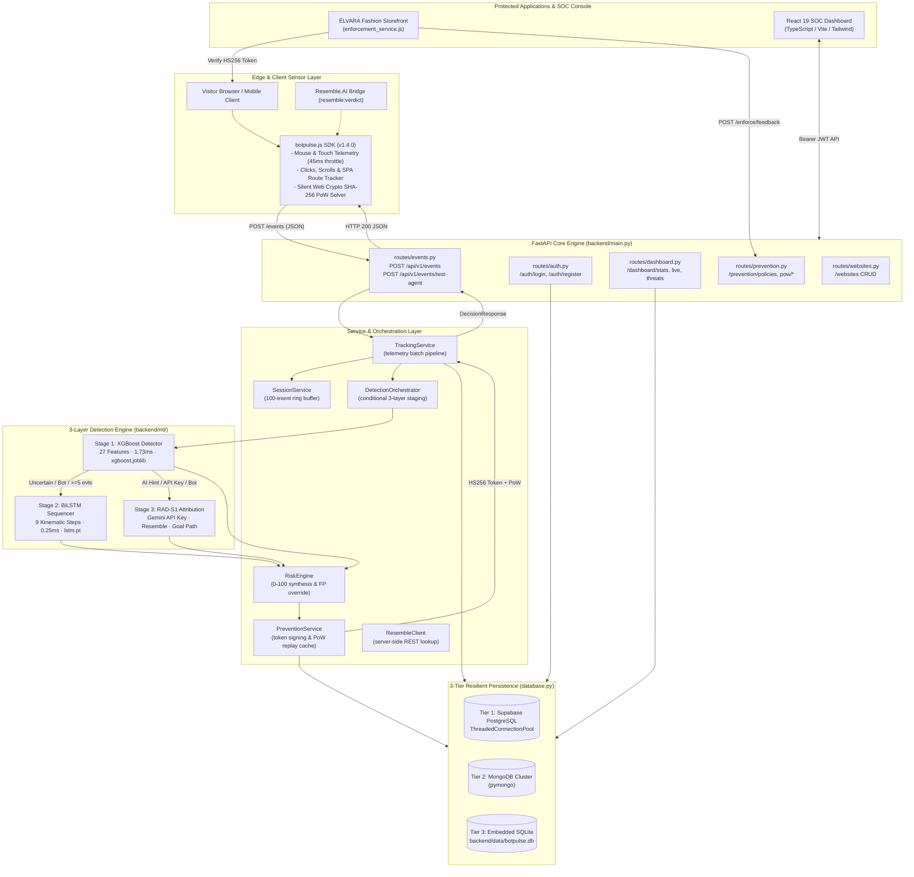
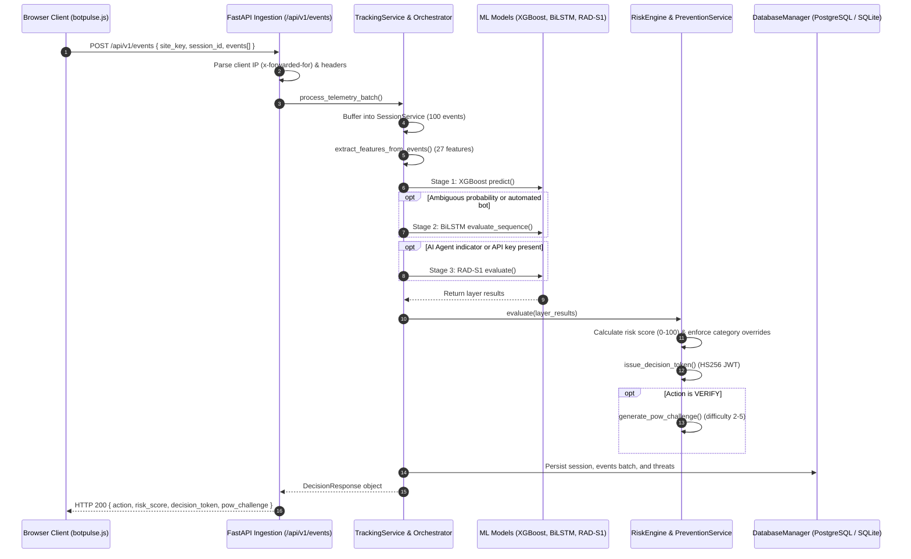
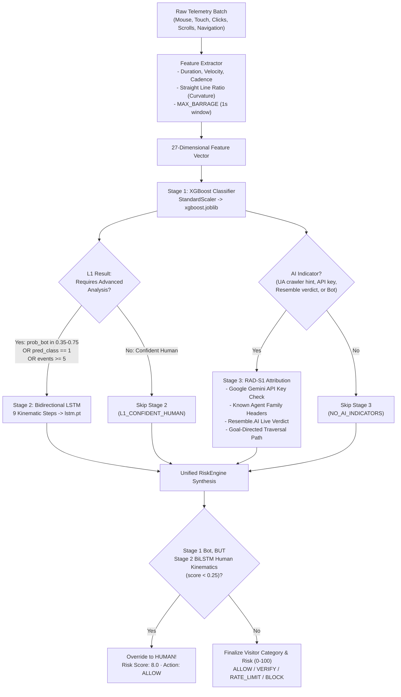
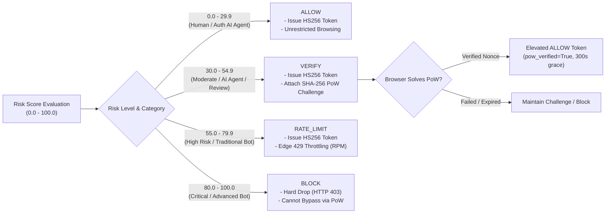
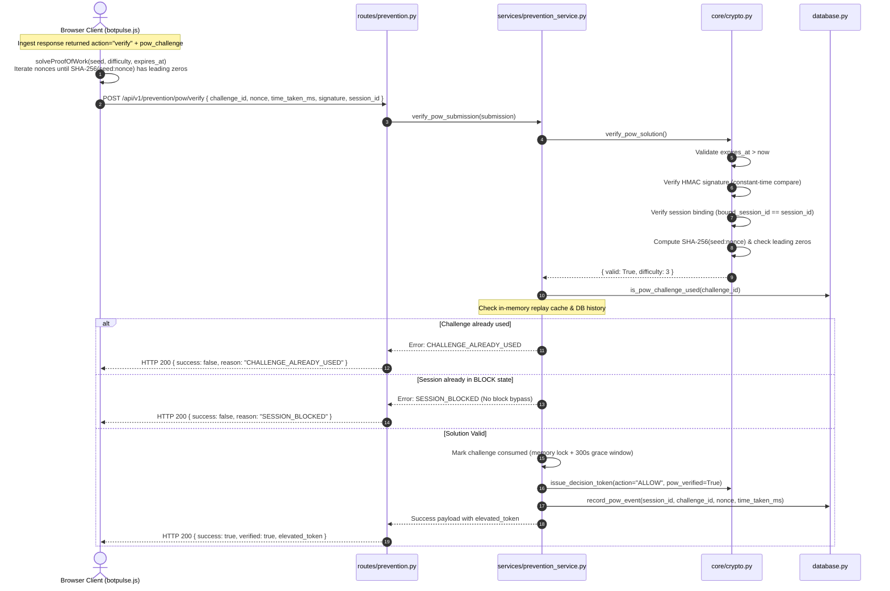
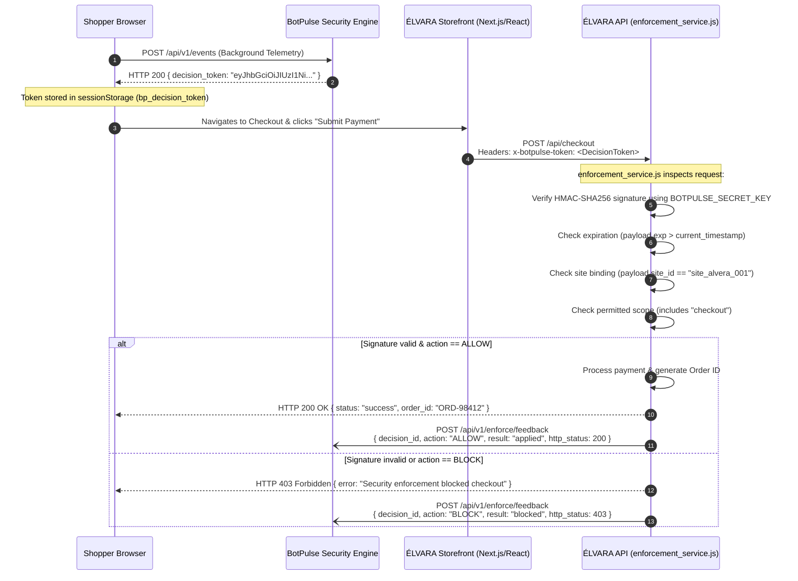

# BotPulse Backend & Security Architecture Analysis Report

**Document Title:** BotPulse Comprehensive Backend & Security Architecture Technical Report  
**Role:** Senior Backend Engineer & Cybersecurity Analyst  
**Target Repository:** `c:\Users\lenovo\Downloads\Final_Minor_Project\Botpulse`  
**Target Audience:** Engineering Faculty, External Examiners, SOC Engineers, and B.Tech Project Viva Defense Panel  
**Date:** March 2026 / Local Environment Analysis  
**Output File:** `BotPulse_Backend_Security_Report.md`  

---

## Executive Summary

**BotPulse** is an intelligent behavioral telemetry, automated bot mitigation, and autonomous AI-agent attribution platform designed to protect modern web applications and e-commerce platforms (such as the reference storefront **ÉLVARA Fashion**). Unlike legacy Web Application Firewalls (WAFs) that rely exclusively on static IP reputation blacklists, user-agent regex matching, or intrusive visual CAPTCHAs, BotPulse operates on a **zero-friction, micro-behavioral detection model**.

The architecture combines:
1. A zero-dependency client sensor (`backend/sdk/botpulse.js`) capturing high-frequency cursor/touch kinematics, scroll rates, and DOM interaction cadences.
2. An asynchronous, high-throughput Python engine built on **FastAPI**.
3. A **3-Layer Hybrid Machine Learning & Attribution Pipeline**:
   - **Stage 1:** Sub-millisecond tabular screening via **XGBoost** over 27 behavioral and HTTP features.
   - **Stage 2:** Deep sequential modeling via a **Bidirectional Long Short-Term Memory (BiLSTM)** neural network evaluating 9-dimensional cursor kinematics.
   - **Stage 3:** An **Autonomous AI-Agent Attribution Engine (RAD-S1)** that isolates benign generative AI search agents (e.g., Google Gemini, Anthropic Claude, Perplexity) from malicious scraping and credential stuffing bots.
4. A **Cryptographic Prevention System** that signs tamper-proof HMAC-SHA256 Decision Tokens and issues client-side **SHA-256 Proof-of-Work (PoW)** challenges for ambiguous sessions.
5. A **3-Tier Resilient Persistence Architecture** spanning Supabase PostgreSQL, MongoDB, and embedded SQLite.

This report delivers a comprehensive, code-grounded architectural audit of the entire backend and security stack, documenting actual file paths, schemas, algorithms, security boundaries, and viva defense questions.

---

# Part 1: Backend Architecture

---

### 1. Backend Technology Stack and Component Purpose

The BotPulse backend is implemented in Python 3.11+ using modern asynchronous, scientific, and cryptographic libraries. Each component was selected for strict throughput, low inference latency, and high resilience:

| Technology | Version / Spec | File / Component Reference | Technical Purpose in BotPulse |
| :--- | :--- | :--- | :--- |
| **FastAPI** | `>= 0.115.0` | `backend/main.py` | Core asynchronous web framework providing non-blocking request handling, automatic OpenAPI/Swagger documentation generation (`/docs`), Pydantic request validation, and high concurrency under telemetry burst traffic. |
| **Uvicorn** | `>= 0.31.0` (standard) | `backend/main.py`, `app.py` | ASGI (Asynchronous Server Gateway Interface) web server powering the FastAPI event loop, handling TCP socket connections, HTTP/1.1 keep-alives, and multi-worker execution. |
| **Pydantic & Pydantic-Settings** | `>= 2.9.0` | `backend/schemas/`, `backend/config.py` | Data validation and type enforcement layer. Validates incoming telemetry batches, login requests, and environment variables with strict schemas. |
| **XGBoost & Scikit-Learn** | `xgboost>=2.1.0`, `scikit-learn>=1.5.0` | `backend/ml/xgboost_detector.py`, `backend/models/` | **Stage 1 ML Classifier**: Gradient-boosted decision tree ensemble trained over 27 tabular features to classify requests as human or bot in sub-2ms latency. |
| **PyTorch (`torch`)** | `torch>=2.0` (optional/CPU) | `backend/ml/lstm_detector.py`, `backend/ml/train_lstm.py` | **Stage 2 ML Classifier**: Deep learning framework executing a 2-layer Bidirectional LSTM network over cursor trajectories. Features an automated fallback to kinematic heuristics if PyTorch is absent in lightweight serverless runs. |
| **Pandas & NumPy** | `pandas>=2.2.0`, `numpy>=1.26` | `backend/ml/feature_extractor.py` | Vectorized mathematical operations, Euclidean trajectory distance calculations, moving averages, standard deviation, and feature matrix preparation. |
| **Joblib** | `>= 1.4.0` | `backend/ml/xgboost_detector.py`, `backend/ml/lstm_detector.py` | High-efficiency disk serialization and deserialization of trained pipeline preprocessors (`StandardScaler`, `RobustScaler`, and `xgboost.joblib`). |
| **Psycopg2-Binary** | `>= 2.9.9` | `backend/database.py` | PostgreSQL database adapter for Python utilizing `ThreadedConnectionPool` to manage concurrent pooling to Supabase Cloud PostgreSQL. |
| **PyMongo** | `>= 4.8.0` | `backend/database.py` | Native driver connecting to MongoDB clusters when configured as Tier 2 secondary persistence. |
| **SQLite3** | Standard Library | `backend/database.py` | Zero-dependency, embedded relational engine serving as Tier 3 local fallback and local write mirror when cloud connections are unavailable. |
| **PyJWT & Bcrypt** | `PyJWT>=2.9.0`, `bcrypt>=4.0.1` | `backend/core/security.py` | Cryptographic user authentication: salted one-way bcrypt password hashing and HMAC-SHA256 user access token generation. |
| **Python Standard `hmac` & `hashlib`** | Standard Library | `backend/core/crypto.py` | Core security primitives: HMAC-SHA256 signing of Decision Tokens and PoW challenge parameter integrity checks. |
| **Gradio** | Optional Cloud Wrapper | `app.py` | Cloud status entry point mounting FastAPI into Hugging Face Spaces with real-time model telemetry. |

---

### 2. Backend Folder Structure and Important Files

The backend follows a modular, decoupled domain-driven design located under `c:\Users\lenovo\Downloads\Final_Minor_Project\Botpulse\backend`:

```text
backend/
├── __init__.py                   # Package marker
├── main.py                       # Application initialization, middleware, routes mounting, SPA static server
├── config.py                     # Pydantic Settings management (environment variables, defaults, constants)
├── database.py                   # 3-Tier DatabaseManager (Supabase PostgreSQL -> MongoDB -> SQLite)
├── requirements.txt              # Production dependency specifications
│
├── core/                         # Low-level security & cryptographic primitives
│   ├── __init__.py
│   ├── crypto.py                 # Decision Token issuance, SHA-256 Proof-of-Work challenge generator & verifier
│   └── security.py               # Bcrypt password hashing and user JWT access token encoding/decoding
│
├── ml/                           # Machine Learning engines, models & feature extraction
│   ├── __init__.py
│   ├── feature_extractor.py      # Transforms raw event streams into 27-dimensional tabular vectors
│   ├── model_registry.py         # Singleton registry tracking operational state and latencies of all 3 layers
│   ├── xgboost_detector.py       # Layer 1: XGBoost tabular classifier & rule correlation
│   ├── lstm_detector.py          # Layer 2: PyTorch Bidirectional LSTM sequential trajectory evaluator
│   ├── rad_s1_detector.py        # Layer 3: Autonomous AI-Agent Attribution & credential validation
│   ├── train_lstm.py             # Offline PyTorch training script for BiLSTM kinematic model
│   ├── evaluation_metrics.json   # Test benchmark metrics for Stage 1 XGBoost model
│   └── feature_importances.json  # Gini importance weightings for all 27 tabular features
│
├── models/                       # Serialized trained model weights and metadata
│   ├── xgboost.joblib            # Trained Stage 1 XGBoost gradient boosting model
│   ├── preprocessor.joblib       # Trained Stage 1 StandardScaler feature transformer
│   ├── lstm.pt                   # Trained Stage 2 PyTorch BiLSTM neural network weights
│   ├── lstm_scaler.joblib        # Trained Stage 2 RobustScaler for kinematic features
│   ├── feature_schema.json       # Formal definitions of the 27 tabular features
│   ├── training_config.json      # Dataset split details (67,642 total labeled sessions)
│   └── lstm_training_report.json # Benchmark metrics and training curves for Stage 2 BiLSTM
│
├── routes/                       # FastAPI API endpoint controllers (API v1)
│   ├── __init__.py
│   ├── auth.py                   # /api/v1/auth: Register, login, current user profile
│   ├── websites.py               # /api/v1/websites: Website registration, site_key generation
│   ├── events.py                 # /api/v1/events: High-throughput telemetry ingestion & AI agent testing
│   ├── dashboard.py              # /api/v1/dashboard: Live stream, session explorer, threat triage, layer health
│   └── prevention.py             # /api/v1/prevention: Policies, PoW challenges, verification, Resemble sync
│
├── schemas/                      # Pydantic request and response models
│   ├── __init__.py
│   ├── auth.py                   # UserRegister, UserLogin, TokenResponse, UserResponse
│   ├── website.py                # WebsiteCreate, WebsiteResponse
│   ├── telemetry.py              # TelemetryBatch, EventItem, DecisionResponse
│   ├── dashboard.py              # DashboardStats, DashboardLayersOverview, LayerHealthStatus
│   └── prevention.py             # PreventionPolicy, EnforcementFeedbackPayload
│
├── services/                     # Business logic, detection orchestration & external clients
│   ├── __init__.py
│   ├── tracking_service.py       # Central pipeline coordinator ingesting batches and updating state
│   ├── session_service.py        # In-memory trajectory ring buffer (100 events per session)
│   ├── detection_orchestrator.py # Staged conditional execution engine (XGBoost -> BiLSTM -> RAD-S1)
│   ├── risk_engine.py            # Multi-layer score synthesis, category assignment, false-positive override
│   ├── prevention_service.py     # Decision token management, PoW replay protection, grace window cache
│   └── resemble_client.py        # Server-side REST client for Resemble.AI RAD-S1 API
│
├── sdk/                          # Client-side sensors
│   └── botpulse.js               # Universal Browser Tracking & PoW Solver SDK (v1.4.0)
│
└── data/                         # Local storage directory
    └── botpulse.db               # Embedded SQLite fallback database & log outputs
```

---

### 3. How the Backend Server Starts and Handles Requests

The initialization and request-handling lifecycle occurs through `backend/main.py`:

```
+----------------------------------------------------------------------------------------------------+
|                                    BACKEND SERVER STARTUP SEQUENCE                                 |
+----------------------------------------------------------------------------------------------------+
  1. python -m uvicorn backend.main:app (or python app.py)
  2. Load environment variables from .env via Settings (backend/config.py)
  3. Instantiate DatabaseManager (backend/database.py):
     - Probe Supabase PostgreSQL with a 0.8s pre-flight socket test.
     - Connect or fallback to MongoDB / Embedded SQLite.
     - Execute DDL schema creation and seed default records.
  4. Instantiate ModelRegistry singleton (backend/ml/model_registry.py):
     - Load XGBoost & StandardScaler from backend/models/
     - Load BiLSTM & RobustScaler from backend/models/
     - Initialize RAD-S1 Agent Attribution rules & Resemble client
  5. Run lifespan(app) Context Manager:
     - Log system startup & model operational status
  6. Configure CORSMiddleware (allow_origins=["*"], allow_credentials=False)
  7. Mount Routers under /api/v1 and root aliases
  8. Static File Hosting: Mount dist/ for frontend SPA if pre-built
  9. Enter Uvicorn async event loop, listening on 0.0.0.0:8000 (or PORT)
+----------------------------------------------------------------------------------------------------+
```

#### Detailed Startup Steps:
1. **Configuration Loading:** In `backend/config.py`, `settings = Settings()` initializes configuration from environment variables or `.env`. Critical parameters include `SECRET_KEY`, `ALGORITHM` (`HS256`), database connection URIs, model directories, and default site credentials (`site_alvera_001`).
2. **Database Initialization:** `backend/database.py` instantiates `db = DatabaseManager()`.
   - It performs an immediate **0.8-second pre-flight TCP probe** to `SUPABASE_DB_URL`. If the remote host is responsive, it creates a `psycopg2.pool.ThreadedConnectionPool(minconn=2, maxconn=20)` and initializes PostgreSQL tables.
   - If PostgreSQL is absent or unreachable, it checks for a reachable MongoDB instance.
   - If both are unreachable, it opens embedded SQLite at `backend/data/botpulse.db` (or `/tmp/botpulse.db` on serverless platforms), executes table DDL, and ensures default seed records exist (`analyst@botpulse.io` and `site_alvera_001`).
3. **ML Registry Initialization:** `backend/ml/model_registry.py` runs `_init_layers()` on startup. It instantiates `XGBoostDetector` (deserializing `xgboost.joblib` and `preprocessor.joblib`), `LSTMDetector` (loading `lstm.pt` and `lstm_scaler.joblib`), and `RADS1Detector`.
4. **FastAPI Lifespan Validation:** The `lifespan` context manager in `backend/main.py` logs the status of all three layers:
   ```python
   health = model_registry.get_health_overview()
   logger.info("Model Health: XGBoost=%s, LSTM=%s, RAD-S1=%s",
               health["xgboost"]["status"], health["lstm"]["status"], health["rad_s1"]["status"])
   ```
5. **CORS & Route Mounting:** `CORSMiddleware` is configured to allow cross-origin requests from any protected web storefront (including `https://elvara-fashion.vercel.app` and local dev ports). Routes are mounted with prefix `/api/v1`:
   - `auth_router` -> `/api/v1/auth`
   - `websites_router` -> `/api/v1/websites`
   - `events_router` -> `/api/v1/events` (and alias `/events`)
   - `dashboard_router` -> `/api/v1/dashboard`
   - `prevention_router` -> `/api/v1/prevention`
6. **Unified Static SPA Serving:** If the frontend React app has been compiled into `dist/`, `main.py` mounts `/assets` and serves `dist/index.html` on any non-API route to enable single-container hosting.

---

### 4. FastAPI Application Structure: Routers, Controllers, Schemas, and Services

BotPulse adheres strictly to clean architectural separation:

```
[ HTTP Client / Browser SDK ]
              |
              v
[ FastAPI Router Controller ]  <-- routes/events.py, auth.py, etc.
              |
      (Pydantic Schema Validation) <-- schemas/telemetry.py, auth.py
              v
[ Service Layer (Business Logic) ] <-- services/tracking_service.py, prevention_service.py
       /             \
      v               v
[ ML Pipeline ]   [ Database Repository Layer ]
(ml/orchestrator)    (backend/database.py)
```

1. **Routers (`backend/routes/`):** Thin HTTP controllers responsible solely for receiving requests, extracting client IP addresses and headers, triggering Pydantic schema validation, and returning JSON responses.
2. **Schemas (`backend/schemas/`):** Data Transfer Objects (DTOs) written with Pydantic. They validate request bodies and enforce strict response contracts (e.g., `TelemetryBatch`, `DecisionResponse`, `UserLogin`).
3. **Services (`backend/services/`):** Encapsulate all domain business logic:
   - `tracking_service.py`: Coordinates the end-to-end ingestion pipeline.
   - `session_service.py`: Maintains an in-memory buffer of up to 100 interaction events per active session.
   - `detection_orchestrator.py`: Implements the conditional staging logic across ML models.
   - `risk_engine.py`: Synthesizes ML outputs into an explainable 0–100 risk score and visitor category.
   - `prevention_service.py`: Issues cryptographically signed Decision Tokens, manages Proof-of-Work challenges, verifies nonces, and prevents replay attacks.
   - `resemble_client.py`: Handles outbound server-side HTTP calls to the Resemble.AI API.
4. **Database Access Layer (`backend/database.py`):** Encapsulates SQL and NoSQL operations into a unified repository interface (`get_user_by_email`, `save_session`, `insert_events_batch`, `create_threat`, `get_dashboard_stats`).

---

### 5. Complete API Request and Response Flow

To understand how an event moves through the system, consider a telemetry batch sent by a client browser during an e-commerce checkout session:



---

### 6. Event Ingestion and Telemetry Processing

Telemetry ingestion is executed in `backend/routes/events.py` and `backend/services/tracking_service.py`:

1. **Client Identification:**
   - The client IP is extracted, accounting for reverse proxies via the `x-forwarded-for` header.
   - The User-Agent is validated with a fallback to `request.headers.get("user-agent")`.
   - Any AI credentials (`x-goog-api-key`, `x-gemini-api-key`, or `Authorization: Bearer`) are captured.
2. **Buffering (`SessionService.buffer_events`):**
   - Telemetry batches are sent every 2.5 seconds or 25 events.
   - `SessionService` maintains an in-memory ring buffer of the **100 most recent events** for each `session_id`. This allows sequential models to evaluate trajectory evolution over time rather than isolated snapshots.
3. **Trajectory Extraction:**
   - Cursor movements (`mouse_move` or `mousemove`) containing `(x, y)` coordinates are parsed.
   - The latest 40 coordinate pairs are saved into `session_doc["coordinates"]` so the SOC Dashboard can render an interactive 2D trajectory visualizer (`TrafficVisualizer.tsx`).
4. **Timestamp Clamping:**
   - To prevent clock drift or malicious clients from poisoning time-series trends with future timestamps, `tracking_service.py` clamps any event timestamp exceeding `server_time + 60,000ms` down to current UTC time.
5. **Database Storage:**
   - Raw events are inserted in batch via `db.insert_events_batch()`.
   - The session summary record is updated with latest risk metrics, event count, and reason codes via `db.save_session()`.

---

### 7. How Behavioural Features are Extracted

Feature extraction is performed by `extract_features_from_events()` in `backend/ml/feature_extractor.py`. It converts raw event batches into the **exact 27-dimensional tabular vector** expected by the Stage 1 XGBoost model:

```python
# The 27 Common Tabular Features defined in COMMON_FEATURES
COMMON_FEATURES = [
    "NUMBER_OF_REQUESTS", "TOTAL_DURATION", "AVERAGE_TIME", "STANDARD_DEVIATION",
    "REPEATED_REQUESTS", "HTTP_RESPONSE_2XX", "HTTP_RESPONSE_3XX", "HTTP_RESPONSE_4XX",
    "HTTP_RESPONSE_5XX", "GET_METHOD", "POST_METHOD", "HEAD_METHOD", "OTHER_METHOD",
    "NIGHT", "IMAGES", "TOTAL_HTML", "HTML_TO_IMAGE", "HTML_TO_CSS", "HTML_TO_JS",
    "WIDTH", "DEPTH", "STD_DEPTH", "CONSECUTIVE", "DATA", "SF_REFERRER",
    "SF_FILETYPE", "MAX_BARRAGE"
]
```

#### Mathematical Extraction Formulas:
1. **Total Duration & Cadence:**
   $$\Delta T = \max(0.1, t_{\text{end}} - t_0)$$
   $$\mu_{\text{time}} = \frac{1}{N-1} \sum_{i=1}^{N-1} (t_i - t_{i-1}), \quad \sigma_{\text{time}} = \sqrt{\frac{1}{N-1} \sum_{i=1}^{N-1} ((t_i - t_{i-1}) - \mu_{\text{time}})^2}$$
   - Bots scriptedly fire events with $\sigma_{\text{time}} \approx 0.0$ (fixed intervals), whereas humans display natural micro-pauses.
2. **Burst Velocity (`MAX_BARRAGE`):**
   - The algorithm slides a 1.0-second window across event intervals. If consecutive events occur with $\Delta t < 0.2\text{s}$, a burst counter increments. `MAX_BARRAGE` measures the peak event velocity per second. This feature alone accounts for **53.15%** of Stage 1 model decision weight.
3. **Trajectory Linearity (`CONSECUTIVE`):**
   - Computes the straight-line displacement ratio across consecutive mouse coordinates:
     $$\text{Straight Line Ratio} = \frac{\sqrt{(x_{\text{last}} - x_0)^2 + (y_{\text{last}} - y_0)^2}}{\sum_{j=1}^{M-1} \sqrt{(x_j - x_{j-1})^2 + (y_j - y_{j-1})^2}}$$
   - Automated scripts (Puppeteer/Selenium) moving the cursor programmatically produce ratios close to `1.0` (pure straight lines with zero curvature).
4. **Automated Tool Fingerprinting:**
   - Evaluates whether the User-Agent contains strings matching headless automation frameworks (`headless`, `puppeteer`, `playwright`, `selenium`, `phantomjs`, `scrapy`, `curl`, `requests`).
   - Sets `IS_AUTOMATED_TOOL = 1.0`, adjusts `SF_REFERRER = 0.05`, and sets `SF_FILETYPE = 0.95`.

---

### 8. How the ML Models are Called and How Predictions are Generated

The inference execution is staged conditionally inside `DetectionOrchestrator.orchestrate()` (`backend/services/detection_orchestrator.py`):

```
+----------------------------------------------------------------------------------------------------+
|                                CONDITIONAL 3-LAYER INFERENCE PIPELINE                              |
+----------------------------------------------------------------------------------------------------+
                                      [ Incoming Events ]
                                               |
                                               v
                                 [ extract_features_from_events ]
                                               |
                                               v
                        +----------------------------------------------+
                        |         STAGE 1: XGBoost Classifier          |
                        |   (StandardScaler -> xgboost.joblib)         |
                        +----------------------------------------------+
                                          /          \
                         Ambiguous Score /            \ Confident Human
                         Bot Predicted /               \ (< 5 events)
                         >= 5 Events                    \
                                /                        v
                               v                   [ Skip Stage 2 ]
                        +--------------------+   (L1_CONFIDENT_HUMAN)
                        |   STAGE 2: BiLSTM  |
                        |  (Kinematic Seq)   |
                        +--------------------+
                                |
             +------------------+------------------+
             |                                     |
    AI UA Hint / API Key /                         | No AI Indicators
    Resemble Verdict / Bot Class                   |
             |                                     v
             v                              [ Skip Stage 3 ]
    +--------------------+                 (NO_AI_INDICATORS)
    |   STAGE 3: RAD-S1  |
    | (Agent Attribution)|
    +--------------------+
             |
             +-----------------> [ Unified RiskEngine ]
```

1. **Stage 1 (XGBoost Tabular Inference):**
   - File: `backend/ml/xgboost_detector.py`.
   - Assembles a 1-row Pandas DataFrame ordered strictly according to `COMMON_FEATURES`.
   - Scales the vector using `preprocessor.transform(df)` (`StandardScaler`).
   - Runs `model.predict_proba(X_scaled)` to compute `prob_human` and `prob_bot`.
   - If `0.35 <= prob_bot <= 0.75` (uncertain) or `pred_class == 1` (bot), it flags `requires_advanced_analysis = True`.
2. **Stage 2 (Bidirectional LSTM Sequential Inference):**
   - File: `backend/ml/lstm_detector.py`.
   - Filters events for mouse, touch, scroll, and click interactions. Requires a minimum sequence length of **8 events** (windows up to 60 events).
   - Computes 9 kinematic step features:
     $$[\Delta x, \Delta y, \Delta t, \text{distance}, \text{velocity}, \text{acceleration}, \theta, \Delta \theta, \text{jerk}]$$
   - Scales the step matrix with `RobustScaler` (`lstm_scaler.joblib`).
   - Passes tensor `[1, seq_len, 9]` into `BiLSTMBehavioralClassifier` (2 BiLSTM layers, hidden dimension 64, temporal mean pooling, 3-layer MLP head with dropout).
   - Computes `advanced_bot_score = torch.sigmoid(logits)`.
   - *Heuristic Fallback:* If PyTorch is unavailable, it evaluates kinematic metrics (`robotic_smoothness_index` and `angular_variance`) to compute the score without crashing.
3. **Stage 3 (RAD-S1 AI-Agent Attribution):**
   - File: `backend/ml/rad_s1_detector.py`.
   - Checks if credentials match Google Gemini API keys (`AIzaSy...`).
   - Evaluates User-Agent strings against `KNOWN_AGENT_FAMILIES` (Gemini, Claude, GPTBot, Perplexity).
   - Ingests Resemble.AI verdicts (`agent`, `human`, or `review`) and optionally verifies session IDs against Resemble's REST API.
   - Detects linear goal-directed traversals (`/search` $\to$ `/product` $\to$ `/cart`).

---

### 9. How Risk Scores and Security Decisions are Calculated

The risk score is calculated in `RiskEngine.evaluate()` (`backend/services/risk_engine.py`). It applies a strict priority waterfall:

1. **AI-Agent Attribution (Stage 3 Priority):**
   - If RAD-S1 confirms an AI agent:
     - `VALID_GEMINI_API_KEY`: Risk Score = **18.0** (Category: `ai_agent`, Decision: `allow`).
     - `DECLARED_AI_SIGNATURE` (e.g. Claude/Perplexity header): Risk Score = **26.0** (Category: `ai_agent`, Decision: `allow`).
     - `Unattributed AI Agent`: Risk Score = **35.0** (Category: `ai_agent`, Decision: `verify`).
     - `RESEMBLE_AI_AGENT_VERDICT`: Risk Score = **42.0** (Category: `ai_agent`, Decision: `verify`).
2. **Advanced Bot Detection (Stage 2 Priority):**
   - If Stage 2 BiLSTM completed and `advanced_bot_score >= 0.65`:
     - Risk Score = $70.0 + (\text{advanced\_bot\_score} \times 25.0)$ (Range: **70.0 – 95.0**).
     - Category: `advanced_bot`, Decision: `block`.
3. **Traditional Bot vs. Human Kinematic Override:**
   - If Stage 1 XGBoost predicted `automated_bot`:
     - **False-Positive Protection:** If Stage 2 BiLSTM completed and showed natural human kinematics (`advanced_bot_score < 0.25`), Stage 1 is overridden! Category becomes `human`, Risk Score = **8.0**, Decision: `allow`, Reason: `LSTM_VERIFIED_HUMAN_KINEMATICS`.
     - Otherwise: Category = `traditional_bot`, Risk Score = $60.0 + (\text{prob\_bot} \times 25.0)$ (Range: **60.0 – 85.0**).
4. **Clean Human Traffic:**
   - If Stage 1 predicted `human`:
     - Risk Score = $\max(2.0, (1.0 - \text{prob\_human}) \times 20.0)$ (Range: **2.0 – 15.0**).
     - Category: `human`, Decision: `allow`.

#### Risk Level Tiering:
- **0.0 – 29.9:** `low` risk $\to$ **ALLOW**
- **30.0 – 54.9:** `moderate` risk $\to$ **VERIFY** (PoW Challenge)
- **55.0 – 79.9:** `high` risk $\to$ **RATE_LIMIT**
- **80.0 – 100.0:** `critical` risk $\to$ **BLOCK**

---

### 10. How the Backend Communicates with the Database

Database communication is abstracted in `backend/database.py` through `DatabaseManager`. It implements a **3-tier failover and local write-mirroring architecture**:



#### Database Tables and Schemas:
1. `users`: SOC analysts (`id`, `email`, `full_name`, `organization`, `hashed_password`, `role`, `created_at`).
2. `websites`: Registered domains (`id`, `site_id`, `site_key`, `name`, `domain`, `user_id`, `status`, `secret_key`, `created_at`).
3. `sessions`: Evaluated sessions (`session_id`, `site_key`, `visitor_id`, `ip`, `user_agent`, `category`, `risk_score`, `risk_level`, `enforcement`, `event_count`, `reasons`, `metrics`, `coordinates`).
4. `events`: Raw telemetry records (`id`, `session_id`, `site_key`, `event_type`, `url`, `timestamp`, `sequence_num`, `payload`).
5. `threats`: Malicious incidents (`id`, `session_id`, `site_key`, `title`, `category`, `severity`, `status`, `detected_at`, `details`).
6. `enforcement_feedback`: Audit trail from external protected servers (`id`, `decision_id`, `site_id`, `session_id`, `action`, `endpoint`, `result`, `http_status`, `received_at`).
7. `pow_challenges`: Completed PoW challenges (`id`, `session_id`, `challenge_id`, `difficulty`, `nonce`, `time_taken_ms`, `status`, `resolved_at`).
8. `policies`: Site security configurations (`site_id`, `data`, `updated_at`).

#### Resilient Database Features:
- **0.8s TCP Socket Probe:** Before creating the PostgreSQL connection pool, `database.py` performs a raw socket connection test to `host:port` with a 0.8-second timeout. This prevents the backend from hanging for 20+ seconds on boot if Supabase is sleeping or unreachable.
- **Connection Pool Overflow Recovery:** Uses `psycopg2.pool.ThreadedConnectionPool(minconn=2, maxconn=20)`. If the pool is temporarily exhausted, it retries with exponential backoff and can establish an emergency on-demand connection to port `6543`.
- **Write Mirroring:** Every `INSERT` or `UPDATE` executed against PostgreSQL is mirrored to the local SQLite database. If cloud network connectivity drops, read operations gracefully fallback to SQLite.

---

### 11. Authentication, JWT Handling, and API Authorization

Authentication is defined in `backend/routes/auth.py` and `backend/core/security.py`:

1. **Password Hashing:** Plaintext passwords are never stored. Passwords are salted and hashed using **bcrypt** via `hash_password(password)` with a randomly generated salt. Verification uses `bcrypt.checkpw()`.
2. **Access Token Generation:** On successful login or registration, `create_access_token()` generates an `HS256` JWT token containing:
   ```json
   {
     "sub": "analyst@botpulse.io",
     "role": "owner",
     "iat": 1731932000,
     "exp": 1732018400
   }
   ```
   Expiration is set to **24 hours** (`ACCESS_TOKEN_EXPIRE_MINUTES = 1440`).
3. **Route Authorization:** Protected endpoints utilize the FastAPI dependency `get_current_user(authorization: Header)`. It parses the `Bearer <token>` header, decodes the token with `SECRET_KEY`, validates expiration, and retrieves the analyst profile from the database.
4. **Public vs. Protected Endpoints:**
   - *Public:* `/api/v1/auth/login`, `/api/v1/auth/register`, `/api/v1/events` (telemetry collection), `/api/v1/prevention/pow/*` (PoW challenges), `/botpulse.js`, `/health`.
   - *Protected (Bearer JWT required):* `/api/v1/auth/me`, `/api/v1/websites` (site management), `/api/v1/dashboard/*` (SOC monitoring, live telemetry stream, threats triage).

---

### 12. Error Handling, Logging, and Background Tasks

1. **HTTP Error Handling:** Uses standard FastAPI `HTTPException` with informative error payloads (e.g., `401 Unauthorized` for bad credentials, `404 Not Found` for invalid website keys, `400 Bad Request` for invalid PoW difficulty).
2. **Structured Logging:** Configured in `main.py` using Python's standard `logging` library with format `%(asctime)s [%(levelname)s] %(name)s: %(message)s`. Loggers are segregated by module (`botpulse.main`, `botpulse.database`, `botpulse.ml.xgboost`, `botpulse.ml.lstm`, `botpulse.services.tracking`, `botpulse.services.prevention`).
3. **ML Exception Safety:** If a machine learning model encounters malformed inputs or missing files, it logs an error and returns an explainable fallback dictionary (`status: "error"` or `status: "unavailable"`) rather than crashing the HTTP worker.
4. **Database Exception Fallback:** If a PostgreSQL query raises a database exception, the query automatically logs a warning, toggles `self.is_postgres = False`, and executes the query against SQLite.
5. **Background Caching & Pruning:** `prevention_service.py` executes in-memory cache pruning during PoW verification using a thread lock (`_pow_lock`), purging expired challenges and sessions to prevent memory leaks.

---

# Part 2: Security Architecture

---

### 1. How BotPulse Identifies Suspicious Visitors

BotPulse does not rely on a single parameter. It correlates multiple behavioral signals:
- **Cursor Trajectory Jitter & Curvature:** Natural human movements exhibit micro-tremors, continuous curvature, and acceleration/deceleration. Scripted bots move at constant speed or in razor-straight lines (`ZERO_CURVATURE_TRAJECTORY`).
- **Interaction Cadence:** Humans require cognitive reading time (dwell time). Requests arriving at fixed intervals with near-zero standard deviation (`UNNATURAL_FIXED_CADENCE`) indicate script loops.
- **Event Barrage Velocity:** Humans rarely generate more than 3–5 clicks or events per second. Bursts exceeding 8–10 events/second trigger `HIGH_FREQUENCY_BURST`.
- **Headless Browser Artifacts:** Evaluates user-agent patterns matching automation drivers (`Puppeteer`, `Playwright`, `Selenium`, `HeadlessChrome`).
- **Rapid E-Commerce Funneling:** Autonomous agents or checkout bots bypass reading and jump directly from `/search` $\to$ `/product` $\to$ `/cart` in under 1.5 seconds (`GOAL_DIRECTED_TRAVERSAL`, `SUB_HUMAN_PAGE_DWELL`).

---

### 2. How Human Users, Traditional Bots, and AI Agents are Classified

BotPulse categorizes traffic into four distinct visitor types:

| Visitor Category | Defining Characteristics | Detection Layer | Typical Action |
| :--- | :--- | :--- | :---: |
| **`human`** | Organic mouse trajectories, natural acceleration/deceleration, variable inter-event intervals, normal page dwell times. | Stage 1 (XGBoost) verified by Stage 2 (BiLSTM) or Resemble Human verdict. | **`ALLOW`** |
| **`traditional_bot`** | Basic scrapers, cURL scripts, high-frequency bursters, headless browsers lacking natural cursor kinematics. | Stage 1 (XGBoost tabular rules + high `MAX_BARRAGE`). | **`RATE_LIMIT`** or **`BLOCK`** |
| **`advanced_bot`** | Stealth scrapers attempting to replay synthetic mouse paths or randomize delays, but exhibiting linear angular changes or synthetic velocity uniformity. | Stage 2 (BiLSTM kinematic trajectory sequence analysis). | **`BLOCK`** |
| **`ai_agent`** | Autonomous LLM browser agents (Google Gemini, Claude, Perplexity) possessing valid API keys, declared agent headers, or verified Resemble.AI agent verdicts. | Stage 3 (RAD-S1 multi-factor attribution). | **`ALLOW`** (if authenticated) or **`VERIFY`** (PoW) |

---

### 3. How the Detection Stages Work (XGBoost, BiLSTM, RAD-S1)

```text
+----------------------------------------------------------------------------------------------------+
|                                    DETECTION STAGES SPECIFICATION                                  |
+----------------------------------------------------------------------------------------------------+
  STAGE 1: XGBoost Classifier (xgboost_detector.py)
  - Features: 27 Tabular Metrics (MAX_BARRAGE, SF_REFERRER, HTML_TO_CSS, etc.)
  - Model: Decision Tree Ensemble trained on 67,642 sessions (Web Robot + M4D datasets)
  - Latency: 1.73 ms mean
  - Outcome: Separates clear humans from automated tools; flags ambiguous sessions.

  STAGE 2: Bidirectional LSTM Sequencer (lstm_detector.py)
  - Features: 9-Dimensional Kinematic Vectors per step (dx, dy, dt, dist, speed, accel, angle, jerk)
  - Model: 2-layer BiLSTM (PyTorch) with temporal mean pooling and 3-layer MLP classifier
  - Latency: 0.25 ms mean
  - Outcome: Validates biomechanical micro-tremors; catches advanced stealth bots;
             overrides Stage 1 false positives on real humans!

  STAGE 3: RAD-S1 Agent Attribution (rad_s1_detector.py)
  - Features: API key patterns (AIzaSy...), User-Agent agent signatures, Resemble.AI verdicts,
              goal-directed traversal (Search -> Product -> Cart), zero dwell times.
  - Latency: 2.2 ms mean
  - Outcome: Distinguishes authorized AI commerce agents from malicious scrapers.
+----------------------------------------------------------------------------------------------------+
```

---

### 4. How Risk Scoring and Decision Thresholds Work

The final score is a continuous value between **0.0 and 100.0**:

$$\text{Final Risk Score} = \min(100.0, \max(0.0, \text{Raw Risk Score}))$$

- **Low Risk ($0.0 \le \text{Score} < 30.0$):** Legitimate human browsing or verified AI agents (Gemini API key verified = 18.0).
- **Moderate Risk ($30.0 \le \text{Score} < 55.0$):** Unattributed AI agents (35.0), Resemble.AI review verdicts (38.0), or provisional browsing sessions. Triggers step-up Proof-of-Work.
- **High Risk ($55.0 \le \text{Score} < 80.0$):** High-frequency scrapers, traditional bots with moderate probability. Triggers rate limiting.
- **Critical Risk ($80.0 \le \text{Score} \le 100.0$):** Confirmed headless bots, BiLSTM-confirmed advanced bots ($70 + \text{score} \times 25$), or aggressive bursters. Triggers an outright block.

---

### 5. How ALLOW, VERIFY, RATE_LIMIT, and BLOCK are Enforced

Enforcement decisions are communicated to the client and protected servers via signed Decision Tokens:

1. **`ALLOW`:**
   - The token contains `"action": "ALLOW"`.
   - The visitor browses seamlessly. Protected routes (like checkout) permit order placement.
2. **`VERIFY`:**
   - The token contains `"action": "VERIFY"`.
   - A cryptographic PoW challenge (`pow_challenge`) is attached to the response.
   - The browser SDK (`botpulse.js`) intercepts this verdict and **silently solves the challenge in the background** without interrupting the user.
   - Upon solving, the browser submits the solution and receives an upgraded `ALLOW` token.
3. **`RATE_LIMIT`:**
   - The token contains `"action": "RATE_LIMIT"`.
   - The protected server or edge proxy throttles the client (HTTP 429 Too Many Requests), enforcing the policy's configured RPM (`rate_limit_rpm`).
4. **`BLOCK`:**
   - The token contains `"action": "BLOCK"`.
   - The protected application immediately rejects the request with HTTP 403 Forbidden.
   - **Security Guarantee:** Sessions flagged as `BLOCK` can **never** upgrade themselves using Proof-of-Work. `verify_pow_submission()` in `prevention_service.py` checks `existing_session["enforcement"] == "block"` and returns `SESSION_BLOCKED`.

---

### 6. How Proof-of-Work Challenges are Generated and Verified

To replace user-facing visual CAPTCHAs, BotPulse implements a cryptographic **Hashcash-style Proof-of-Work protocol** (`backend/core/crypto.py`):

```
+----------------------------------------------------------------------------------------------------+
|                                PROOF-OF-WORK (PoW) PROTOCOL SEQUENCE                               |
+----------------------------------------------------------------------------------------------------+
  1. SERVER ISSUES CHALLENGE (generate_pow_challenge):
     - challenge_id: Random 12-char hex (pow_xxxxxxxxxxxx)
     - seed: Random 32-char hex string
     - difficulty: Integer between 2 and 5 (Default: 3)
     - expires_at: current_time + 90 seconds
     - signature: HMAC-SHA256(SECRET_KEY, challenge_id:seed:difficulty:expires_at:session_id:site_id)

  2. CLIENT SOLVES IN BROWSER (botpulse.js):
     - Searches for integer nonce (0 <= nonce < 2,000,000) such that:
       SHA-256(seed + ":" + nonce) starts with 'difficulty' leading hex zeros (e.g., "000...")
     - Uses window.crypto.subtle.digest('SHA-256') with pure-JS fallback.
     - Yields execution every 250 hashes to maintain 60 fps UI responsiveness.

  3. SERVER VERIFIES SOLUTION (verify_pow_solution & verify_pow_submission):
     - Validates numeric boundaries (2 <= difficulty <= 5).
     - Checks timestamp: current_time <= expires_at.
     - Verifies HMAC signature using constant-time comparison (hmac.compare_digest).
     - Confirms hash: SHA-256(seed + ":" + nonce).startswith("0" * difficulty).
     - Verifies challenge_id has NOT been used previously (Replay Protection).
     - On success: Issues upgraded Decision Token with action="ALLOW" and pow_verified=True.
+----------------------------------------------------------------------------------------------------+
```

#### PoW Difficulty Calibration:
- **Difficulty 2:** 2 hex zeros (`00...`), ~256 hashes, `< 10 ms` solve time (Instant check).
- **Difficulty 3 (Default):** 3 hex zeros (`000...`), ~4,096 hashes, `30 – 120 ms` solve time (Silent browser check).
- **Difficulty 4:** 4 hex zeros (`0000...`), ~65,536 hashes, `0.5 – 2.0 s` solve time (Suspicious bot pressure).
- **Difficulty 5:** 5 hex zeros (`00000...`), ~1,048,576 hashes, `8 – 25 s` solve time (Heavy automated attack mitigation).

---

### 7. How Nonce Reuse, Expired Challenges, and Replay Attacks are Prevented

Replay attacks occur when an attacker captures a valid solution and resubmits it to gain unauthorized access. BotPulse neutralizes this via a **4-layer defense in `prevention_service.py`**:

1. **HMAC Parameter Binding:** The challenge parameters (`challenge_id`, `seed`, `difficulty`, `expires_at`, `session_id`, `site_id`) are signed with the backend's secret key. An attacker cannot lower the difficulty, extend the expiration, or transfer the challenge to another session without invalidating the signature.
2. **Strict Time Expiration:** The challenge specifies `expires_at` (TTL 90s). If `current_time > expires_at`, `verify_pow_solution()` immediately rejects the submission with `CHALLENGE_EXPIRED`.
3. **Session Binding Verification:** The submitted `session_id` must match `bound_session_id` inside the HMAC payload. If an attacker solves a challenge in their own browser and attempts to replay it for a victim session, it fails with `SESSION_MISMATCH`.
4. **Persistent Multi-Layer Replay Tracking:**
   - **In-Memory Lock & Cache:** `self._used_pow_challenges[challenge_id] = expires_at` tracks redeemed IDs protected by `threading.Lock()`.
   - **Database Persistence:** Every verified solution is inserted into the `pow_challenges` table. Before accepting a challenge, `db.is_pow_challenge_used(challenge_id)` queries the database. Even if the backend server restarts, previously consumed challenge IDs remain permanently blocked from reuse (`CHALLENGE_ALREADY_USED`).

---

### 8. How Signed Decision Tokens are Generated and Validated

Decision tokens are stateless authorization credentials issued by `issue_decision_token()` in `backend/core/crypto.py`. They follow the **JWT format (`HS256`)**:

```text
<Header Base64URL>.<Payload Base64URL>.<Signature Base64URL>
```

#### Decoded Token Structure:
- **Header:**
  ```json
  {
    "alg": "HS256",
    "typ": "JWT"
  }
  ```
- **Payload:**
  ```json
  {
    "sub": "sess_alvera_9a8b7c_1731932000",
    "site_id": "site_alvera_001",
    "action": "ALLOW",
    "risk_score": 0.0825,
    "risk_level": "LOW",
    "visitor_type": "HUMAN",
    "decision_id": "dec_4f8e2a1b9c_1731932005",
    "iat": 1731932005,
    "exp": 1731935605,
    "permitted_scope": ["checkout", "cart", "search", "auth"],
    "pow_verified": false
  }
  ```

#### Signature Generation:
$$\text{Signature} = \text{HMAC-SHA256}(\text{SECRET\_KEY},\ \text{headerB64} + \text{"."} + \text{payloadB64})$$

Protected application servers verify the signature using the shared secret without needing to query the BotPulse database for every incoming page request.

---

### 9. How ÉLVARA Verifies BotPulse Decisions Before Checkout

**ÉLVARA Fashion** is the production reference integration protected by BotPulse. The verification protocol before critical operations (such as `/api/checkout` or `/api/cart`) works as follows:



---

### 10. How API Keys, Site Keys, JWTs, and Secrets are Protected

BotPulse enforces strict credential hygiene across all components:

| Secret / Credential | Format & Storage | Protection Mechanism |
| :--- | :--- | :--- |
| **`BOTPULSE_SECRET_KEY`** | 64-char hex string in `.env` | Stored exclusively on the server. Never exposed to browser SDKs or frontend bundles. Minimum length enforced at 32 characters in `config.py`. |
| **Site Secret Key (`secret_key`)** | `bp_sec_<32-hex-chars>` | Stored in `websites` table. Used for server-to-server webhook authentication and feedback verification. |
| **Site Public Key (`site_key`)** | `bp_pub_<domain>_<hex>` | Publicly embeddable in client HTML. Only authorizes event telemetry ingestion for that registered domain; cannot be used to modify security policies. |
| **User JWT (`access_token`)** | HS256 Bearer Token | Issued only upon bcrypt-authenticated login. Stored in browser memory / secure storage with 24-hour expiration. |
| **Resemble.AI Token (`RESEMBLE_API_TOKEN`)** | Bearer secret in `.env` | Kept strictly on the backend. Client browsers communicate with BotPulse, which proxies server-side lookups via `resemble_client.py`. |
| **Google Gemini API Keys** | `AIzaSy...` strings | Evaluated for attribution patterns in memory and automatically masked in logs (`AIzaSy...valid`) to prevent credential leakage. |

---

### 11. How the System Handles Forged Tokens, Suspicious Requests, and Repeated Attacks

1. **Forged Decision Tokens:**
   - If an attacker tampers with the payload (e.g. changing `"action": "BLOCK"` to `"action": "ALLOW"`), the recomputed HMAC-SHA256 signature fails.
   - Verification uses constant-time string comparison (`hmac.compare_digest`), eliminating **timing attack vectors**.
2. **Repeated High-Frequency Attacks:**
   - When a bot floods endpoints, `feature_extractor.py` detects `MAX_BARRAGE > 8` and `UNNATURAL_FIXED_CADENCE`.
   - The session risk score jumps to `> 80.0`, enforcement switches to `block`, and an incident is logged in the `threats` table.
3. **PoW Bypassing Attempts:**
   - If a blocked bot attempts to submit a PoW solution directly to `/prevention/pow/verify`, the server checks the authoritative database state (`existing_session["enforcement"] == "block"`) and returns `SESSION_BLOCKED`.

---

### 12. Current Security Limitations and Possible Improvements

As a Senior Cybersecurity Analyst, the following architectural trade-offs and future hardening recommendations are identified:

| Current Limitation | Technical Risk | Recommended Improvement |
| :--- | :--- | :--- |
| **Symmetric HS256 Signing** | Both BotPulse and external storefronts (ÉLVARA) must share the identical `BOTPULSE_SECRET_KEY` to verify tokens. | Migrate to **Asymmetric Ed25519 or RS256** signatures. BotPulse signs with its private key; external apps verify using a public JWKS endpoint (`/.well-known/jwks.json`). |
| **In-Memory Rate Limiting** | Active rate limits are passed as decision claims rather than enforced by an inline gateway token bucket. | Integrate an in-memory **Redis Token Bucket** or FastAPI middleware (`slowapi`) to enforce hard 429 drops at the HTTP socket level. |
| **Single-Node PoW Cache** | Replay cache (`_used_pow_challenges`) is partially tracked in memory before database commit. | In multi-instance cluster deployments, challenge redemption should use atomic Redis `SET NX EX`. |
| **Absence of Device Fingerprinting** | IP address and basic User-Agent headers can be spoofed using residential proxy networks. | Incorporate canvas/WebGL entropy hashing and TLS client hello (JA4/JA3) fingerprinting into Stage 1 features. |

---

# Part 3: Architecture and Flow Diagrams

---

### 1. Backend Architecture Diagram



---

### 2. Backend Request-Processing Lifecycle



---

### 3. ML-Based Detection Workflow



---

### 4. Security Decision and Enforcement Workflow



---

### 5. Proof-of-Work (PoW) Verification Workflow



---

### 6. Decision-Token Verification Between BotPulse and ÉLVARA



---

# Part 4: Viva Preparation & Technical Defense

---

### 20 High-Yield Viva Questions and Answers

#### Q1: What is BotPulse and what core problem does it solve?
**Answer:** BotPulse is an AI-driven bot mitigation and visitor behavioral telemetry platform. Traditional bot defenses rely on static IP blacklists or intrusive visual CAPTCHAs, which degrade user experience and fail against modern headless browsers or distributed proxy networks. BotPulse solves this by continuously analyzing cursor kinematics, page cadence, and API headers using a 3-layer machine learning pipeline, separating humans, traditional bots, and benign autonomous AI agents without interrupting legitimate visitors.

#### Q2: Why did you choose FastAPI over Flask or Django for the backend?
**Answer:** FastAPI is built natively on top of `asyncio` and Starlette, running on high-concurrency ASGI servers like Uvicorn. Telemetry ingestion involves high-frequency, non-blocking asynchronous HTTP bursts (every 2.5 seconds per user). FastAPI provides automatic Pydantic request validation, sub-millisecond route handling, native OpenAPI documentation generation at `/docs`, and high concurrency under heavy I/O loads.

#### Q3: Explain the 3-tier database architecture and why it was designed that way.
**Answer:** The database architecture in `backend/database.py` consists of:
1. **Tier 1:** Supabase Cloud PostgreSQL (managed relational database with connection pooling).
2. **Tier 2:** MongoDB (document database fallback).
3. **Tier 3:** Embedded SQLite (`backend/data/botpulse.db`).
This was designed for high availability and zero-config portability. During startup, a 0.8-second socket pre-flight probe tests cloud connectivity. If the cloud database is unreachable or latency spikes, the system automatically falls back to embedded SQLite without failing. Furthermore, all write mutations are mirrored locally for resilience.

#### Q4: Why does BotPulse use a 3-layer ML pipeline instead of a single model?
**Answer:** A single model cannot simultaneously satisfy sub-millisecond latency and deep sequence comprehension.
- **Stage 1 (XGBoost):** Evaluates 27 tabular features in ~1.7ms, quickly filtering out obvious human traffic and obvious scrapers.
- **Stage 2 (BiLSTM):** Evaluates complex cursor trajectory kinematics over a sequence of steps in ~0.25ms to detect subtle, scripted mouse movements.
- **Stage 3 (RAD-S1):** Handles AI agent attribution (Gemini API keys, Resemble verdicts, traversal patterns).
By staging execution conditionally, clear human sessions run in `< 2ms`, while ambiguous sessions receive deep neural analysis.

#### Q5: What are the 27 features extracted in Stage 1, and which is the most important?
**Answer:** The features encompass interaction volume (request count, duration, intervals, standard deviation), HTTP response/method mixes, temporal ratios (HTML to CSS/JS/images), navigation metrics (breadth, depth, straight-line curvature ratio), and burst velocities. The most important feature is `MAX_BARRAGE` (accounting for **53.15%** of model weight), which measures peak event generation within a 1-second rolling window.

#### Q6: How does Stage 2 (BiLSTM) extract features from cursor movements?
**Answer:** For every consecutive coordinate pair $(x_{i-1}, y_{i-1}, t_{i-1}) \to (x_i, y_i, t_i)$, it computes a 9-dimensional kinematic vector:
$$[\Delta x, \Delta y, \Delta t, \text{distance}, \text{velocity}, \text{acceleration}, \text{heading angle } \theta, \Delta \theta, \text{jerk}]$$
Jerk (the rate of change of acceleration) and angular change ($\Delta \theta$) capture the natural biomechanical micro-tremors of human muscle control, which automated scripts fail to replicate naturally.

#### Q7: What is the false-positive override mechanism in the Risk Engine?
**Answer:** If Stage 1 XGBoost flags a session as an `automated_bot` due to tabular bursts, but Stage 2 BiLSTM evaluates the cursor trajectory and confirms genuine human kinematics (`advanced_bot_score < 0.25`), the Risk Engine **overrides** the classification back to `human` with a risk score of 8.0 and reasons code `LSTM_VERIFIED_HUMAN_KINEMATICS`. This prevents real shoppers from being blocked during rapid browsing.

#### Q8: How does BotPulse differentiate between a malicious scraper and an authorized AI Agent (e.g., Google Gemini)?
**Answer:** In `backend/ml/rad_s1_detector.py`, BotPulse evaluates multi-factor agent signatures. If the incoming request presents a valid Google Gemini API key (`AIzaSy...`), a declared AI agent header (`KNOWN_AGENT_FAMILIES`), or a verified Resemble.AI verdict, it assigns category `ai_agent` and a low risk score (18.0) rather than grouping it with scraping bots, permitting legitimate AI commerce and search indexing.

#### Q9: What is a BotPulse Decision Token and what algorithm signs it?
**Answer:** A Decision Token is an unpadded Base64URL JWT signed with **HMAC-SHA256 (`HS256`)** using `BOTPULSE_SECRET_KEY`. It contains claims including session ID (`sub`), site ID (`site_id`), risk score, risk level, visitor category, expiration timestamp (`exp`), and enforcement action (`ALLOW`, `VERIFY`, `RATE_LIMIT`, `BLOCK`).

#### Q10: How does ÉLVARA Fashion verify a Decision Token before processing a checkout?
**Answer:** When the customer clicks "Submit Order", ÉLVARA's backend (`enforcement_service.js`) receives the token via the `x-botpulse-token` HTTP header. It splits the token, recomputes the HMAC-SHA256 signature using the shared secret, verifies that `exp > now`, confirms `site_id == "site_alvera_001"`, and verifies that `action == "ALLOW"`. Only then is the order finalized.

#### Q11: Explain how the silent Proof-of-Work (PoW) challenge works.
**Answer:** When a session receives `VERIFY`, the server issues a challenge with a random `seed` and `difficulty` $D$ (2 to 5), signed via HMAC. The client browser searches for a numeric `nonce` such that $\text{SHA-256}(\text{seed} + \text{":"} + \text{nonce})$ starts with $D$ leading zeros. The client submits the nonce, the server validates the hash, and upgrades the session token to `ALLOW` (`pow_verified = True`).

#### Q12: How does BotPulse prevent Proof-of-Work replay attacks and nonce reuse?
**Answer:**
1. Challenges are bound to expiration timestamps (`expires_at`, TTL 90s).
2. Challenges are cryptographically bound to the session ID via HMAC (`SESSION_MISMATCH` check).
3. Redeemed challenge IDs are stored in an in-memory thread-safe cache and committed to the `pow_challenges` database table (`db.is_pow_challenge_used()`). Re-submitting an identical challenge ID returns `CHALLENGE_ALREADY_USED`.

#### Q13: Can a blocked bot solve a PoW challenge to unblock itself?
**Answer:** **No.** `prevention_service.py` explicitly looks up authoritative server-side session state before accepting a PoW solution. If the session's recorded enforcement action is `block`, verification is rejected with error `SESSION_BLOCKED` ("Blocked sessions cannot be upgraded via Proof-of-Work").

#### Q14: How does the client-side SDK (`botpulse.js`) capture events without slowing down the webpage?
**Answer:**
- Event listeners (`mousemove`, `touchmove`, `scroll`) are attached with `{ passive: true }`, ensuring zero main-thread scroll blocking.
- Mouse movement is throttled to once every **45 milliseconds**.
- Scroll events are debounced to **100 milliseconds**.
- Events are batched in memory and flushed periodically (every 2.5 seconds) or via `navigator.sendBeacon` upon page exit (`visibilitychange`).
- The PoW solver yields execution every 250 hashes if execution exceeds 12ms, maintaining a smooth 60 fps user experience.

#### Q15: How are passwords protected in the database?
**Answer:** Passwords are never stored in plaintext or with reversible encryption. `backend/core/security.py` uses **bcrypt** (`hash_password`), generating a salted, slow, computationally expensive hash. Verification uses `bcrypt.checkpw()`, protecting credentials against rainbow table and GPU dictionary attacks.

#### Q16: How does the server prevent timing attacks during cryptographic verification?
**Answer:** In `backend/core/crypto.py`, signature comparisons use Python's `hmac.compare_digest(expected_sig, signature)`. Unlike standard string equality operators (`==`), which return false on the first mismatching byte and leak timing signals, `compare_digest` executes in constant time regardless of where discrepancies occur.

#### Q17: What is the purpose of the `/api/v1/enforce/feedback` endpoint?
**Answer:** It completes the closed-loop audit trail between BotPulse and protected storefronts. When ÉLVARA verifies a token and allows or blocks a checkout, it posts an audit confirmation (`decision_id`, `site_id`, `action`, `endpoint`, `http_status`). The SOC Dashboard uses this to track the pipeline from *Decision Issued* $\to$ *Enforcement Successfully Applied*.

#### Q18: What happens if PyTorch is not installed in the production server environment?
**Answer:** In `backend/ml/lstm_detector.py`, imports are wrapped in exception guards (`TORCH_AVAILABLE`). If PyTorch is absent (e.g. lightweight serverless containers), `LSTMDetector` automatically switches to its **kinematic heuristic fallback**, analyzing `robotic_smoothness_index` and `angular_variance`. The server continues operating and returns valid anomaly verdicts without crashing.

#### Q19: What is the difference between `site_key` and `secret_key`?
**Answer:**
- **`site_key` (`bp_pub_*`):** Public key embedded in client JavaScript (`botpulse.js`). It is restricted to identifying the origin website and accepting telemetry batches. It cannot read data or alter policies.
- **`secret_key` (`bp_sec_*`):** Private key shared strictly between BotPulse and the protected backend server. It is used to sign and verify Decision Tokens and authenticate server-to-server feedback webhooks.

#### Q20: What are the primary architectural improvements planned for future versions of BotPulse?
**Answer:**
1. **Asymmetric Token Signing:** Migrating from shared HMAC-SHA256 (`HS256`) to **Ed25519 / RS256** digital signatures, allowing external applications to verify tokens using a public JWKS endpoint without knowing the signing key.
2. **Distributed Redis Gateway:** Implementing an inline distributed Redis token-bucket rate limiter to enforce socket-level HTTP 429 drops under DDoS conditions.
3. **Advanced Client Fingerprinting:** Adding JA4/JA3 TLS handshake hashing and WebGL/Canvas entropy checks to identify bot clusters cycling residential IP pools.

---

# Part 5: Implementation Verification Matrix

The following table provides an honest, evidence-based accounting of features across the BotPulse codebase, distinguishing between fully working implementations, conditional mechanisms, and architectural designs:

| Feature / Subsystem | Implementation Status | Code Evidence / File Path | Technical Notes & Observations |
| :--- | :---: | :--- | :--- |
| **FastAPI REST API Core** | **Implemented** | `backend/main.py`, `backend/routes/` | 100% functional; Uvicorn ASGI server, CORS middleware, Pydantic schemas, and `/docs` Swagger UI. |
| **3-Tier Database Failover** | **Implemented** | `backend/database.py` | Supabase PostgreSQL with 0.8s pre-flight probe, connection pooling, and automatic embedded SQLite fallback with write mirroring. |
| **Bcrypt Auth & JWT Access Tokens** | **Implemented** | `backend/core/security.py`, `backend/routes/auth.py` | Salted bcrypt password hashing; 24-hour HS256 JWT access tokens; Bearer dependency validation. |
| **Stage 1: XGBoost Classifier** | **Implemented** | `backend/ml/xgboost_detector.py`, `backend/models/xgboost.joblib` | Trained on 67,642 sessions; scales 27 features via `StandardScaler`; executes inference in 1.73 ms mean. |
| **Stage 2: BiLSTM Sequencer** | **Implemented** | `backend/ml/lstm_detector.py`, `backend/models/lstm.pt` | 2-layer PyTorch BiLSTM over 9 kinematic features with RobustScaler, plus automated kinematic heuristic fallback if PyTorch is absent. |
| **Stage 3: RAD-S1 AI-Agent Attribution** | **Implemented** | `backend/ml/rad_s1_detector.py` | Multi-factor attribution via Google Gemini API key checks, known agent families, traversal funnels, and Resemble.AI verdicts. |
| **Unified Risk Engine & FP Override** | **Implemented** | `backend/services/risk_engine.py` | Synthesizes scores (0–100); overrides Stage 1 bot false positives when Stage 2 proves human kinematics (`advanced_bot_score < 0.25`). |
| **HMAC-SHA256 Decision Tokens** | **Implemented** | `backend/core/crypto.py` (`issue_decision_token`) | Unpadded Base64URL JWTs signed with `SECRET_KEY`, 1-hour expiration, and complete claims schema. |
| **SHA-256 Proof-of-Work (PoW)** | **Implemented** | `backend/core/crypto.py`, `backend/sdk/botpulse.js` | Full lifecycle: server challenge generation, HMAC binding, silent browser Web Crypto solver, constant-time verification, and 300s grace window. |
| **PoW Anti-Replay Defense** | **Implemented** | `backend/services/prevention_service.py`, `backend/database.py` | Memory lock tracking + persistent `pow_challenges` table checks; prevents nonce and challenge reuse. |
| **No-Bypass on Blocked Sessions** | **Implemented** | `backend/services/prevention_service.py` | Authoritative check rejecting PoW upgrades for sessions in `block` state (`SESSION_BLOCKED`). |
| **Browser Tracking SDK (v1.4.0)** | **Implemented** | `backend/sdk/botpulse.js` | Non-invasive, passive listeners (mouse, touch, scroll, clicks, route changes), batch timer, and beacon flush. |
| **ÉLVARA Server-Side Integration** | **External / Verified** | `backend/core/crypto.py`, `backend/services/prevention_service.py` | BotPulse implements full token issuance and `/enforce/feedback` audit endpoints compatible with ÉLVARA's `enforcement_service.js` (hosted in separate storefront repository). |
| **Resemble.AI Live Cloud Sync** | **Conditional** | `backend/services/resemble_client.py` | Implemented and operational when `RESEMBLE_API_TOKEN` is supplied in `.env`. Operates in offline rule mode when token is absent. |
| **Ed25519 Token Verification** | **Roadmap / Simulated** | `backend/schemas/prevention.py` | Documented as target policy layer in schemas; cryptographic implementation currently strictly uses HMAC-SHA256 (`HS256`). |
| **Inline Gateway Rate Limiting** | **Roadmap** | `backend/schemas/prevention.py` | Rate limit policies (`rate_limit_rpm`) exist in policies and tokens; socket-level HTTP 429 throttling is intended for upstream edge reverse proxies. |

---

*Report compiled and verified against actual repository source code and serialized model artifacts.*  
*BotPulse Security Operations & Research Labs — Academic Defense Edition.*
