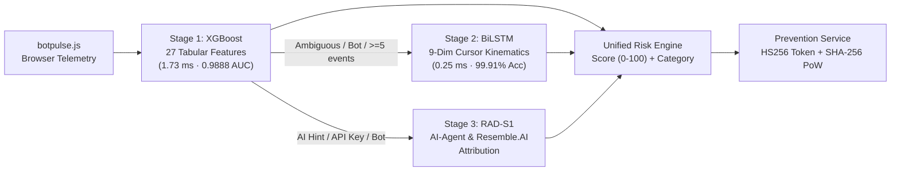

# 🛡️ BotPulse — Next-Gen AI Bot Detection, Behavioral Telemetry & Autonomous Prevention Engine

**BotPulse** is a full-stack web security platform that distinguishes **real human visitors**, **traditional scrapers**, **stealth/advanced bots**, and **legitimate autonomous AI agents** (such as Google Gemini, Anthropic Claude, OpenAI GPTBot/ChatGPT-User, and Perplexity) in real time—without relying on intrusive visual CAPTCHAs.

It combines a zero-dependency browser telemetry SDK (`botpulse.js`), a **3-layer hybrid machine learning pipeline** (XGBoost + PyTorch Bidirectional LSTM + RAD-S1 AI-Agent Attribution), **cryptographically signed Decision Tokens (`HS256`)**, **silent SHA-256 Proof-of-Work challenges**, a **3-tier resilient database** (Supabase PostgreSQL → MongoDB → SQLite), and an **11-module React 19 SOC Dashboard**.

---

## 📚 Complete Documentation Guide

Start here to learn and understand every layer of the system:

| Guide | What You Will Learn |
| :--- | :--- |
| **[1. System Architecture & Data Flow](./docs/01-architecture.md)** | High-level architecture, end-to-end request lifecycle sequence diagram, and full directory map. |
| **[2. 3-Layer Hybrid ML Detection Engine](./docs/02-ml-detection-engine.md)** | Deep dive into Stage 1 XGBoost (27 features), Stage 2 BiLSTM (9 kinematic trajectory features), Stage 3 RAD-S1 AI-Agent attribution, and the Unified Risk Engine. |
| **[3. Browser SDK, Decision Tokens & Proof-of-Work](./docs/03-sdk-and-prevention.md)** | How to embed `botpulse.js`, verify signed `HS256` decision tokens, and how silent SHA-256 PoW prevents bot abuse without CAPTCHAs. |
| **[4. REST API Reference](./docs/04-api-reference.md)** | Every FastAPI endpoint (`/auth`, `/websites`, `/events`, `/dashboard`, `/prevention`, `/resemble`) with request/response examples. |
| **[5. Database Architecture & SOC Dashboard](./docs/05-database-and-frontend.md)** | 3-tier DB failover, Entity-Relationship diagram of all 8 tables, and React 19 SOC dashboard route map. |
| **[6. Local Setup, Training & Cloud Deployment](./docs/06-setup-and-deployment.md)** | Step-by-step local run instructions, test `curl` commands, model retraining, Docker, Hugging Face Spaces, Vercel, and troubleshooting. |

---

## 🧠 Three-Layer Hybrid Detection Pipeline



| Detection Layer | Model / Engine | Benchmark Performance | Primary Role |
| :--- | :--- | :--- | :--- |
| **Stage 1** | **XGBoost Classifier** (`xgboost.joblib`) | **92.65%** Accuracy · **0.9888** ROC-AUC · **96.82%** Bot Recall · **1.73 ms** mean | Sub-millisecond screening of 27 session/HTTP features (trained on 67,642 M4D + Web Robot sessions). |
| **Stage 2** | **Bidirectional LSTM** (`lstm.pt`) | **99.91%** Accuracy · **0.9994** F1 · **1.0000** ROC-AUC · **0.25 ms** mean | Deep trajectory kinematics (`dx, dy, dt, dist, speed, accel, angle, d_angle, jerk`) catching stealth bots & overriding human false positives. |
| **Stage 3** | **RAD-S1 Attribution** (`rad_s1_detector.py`) | Multi-factor + Resemble.AI server verification | Identifies Google Gemini (API key & UA), Claude, GPTBot, Perplexity, and autonomous web agents separately from malicious bots. |

---

## ⚡ Quick Start (Run Locally in 2 Minutes)

### 1. Configure Environment
```bash
cp .env.example .env
# Generate a 32+ char secret for BOTPULSE_SECRET_KEY in .env:
python -c "import secrets; print(secrets.token_urlsafe(32))"
```

### 2. Start the FastAPI Backend (`http://127.0.0.1:8000`)
```bash
python -m venv .venv
.venv\Scripts\Activate.ps1            # Windows PowerShell (macOS/Linux: source .venv/bin/activate)
pip install -r backend/requirements.txt
uvicorn backend.main:app --host 127.0.0.1 --port 8000 --reload
```
*(No external database required locally—BotPulse automatically uses embedded SQLite at `backend/data/botpulse.db` if `SUPABASE_DB_URL` is not configured. Optionally run `pip install torch` to enable neural Stage 2 BiLSTM weights alongside the built-in kinematic fallback.)*

### 3. Start the React 19 SOC Dashboard (`http://localhost:5173`)
```bash
npm install
npm run dev
```

### Default SOC Analyst Credentials
- **Dashboard Login:** `analyst@botpulse.io` / `botpulse2026!`
- **Swagger API Docs:** `http://127.0.0.1:8000/docs`
- **Health Telemetry:** `http://127.0.0.1:8000/health`
- **Universal Tracking SDK:** `http://127.0.0.1:8000/botpulse.js`

---

## ☁️ 24/7 Cloud Deployment Summary

- **Backend on Hugging Face Spaces (Free 2 vCPU · 16 GB RAM):** Select **Space SDK: Gradio** and connect this repository. Hugging Face boots `app.py` (which mounts both the FastAPI engine and live Gradio status UI) on port `7860`. Add `BOTPULSE_SECRET_KEY` (and optional `SUPABASE_DB_URL`) in Space Secrets.
- **Frontend on Vercel (Free Global CDN):** Import the repository with preset **Vite** (`npm run build`, output `dist`), set `VITE_API_URL` (or configure rewrites in `vercel.json`), and deploy.
- **Docker (All-in-One):** Run `npm run build && docker build -t botpulse . && docker run -p 8000:8000 -e BOTPULSE_SECRET_KEY=... botpulse`.

See **[6. Local Setup, Training & Cloud Deployment](./docs/06-setup-and-deployment.md)** for full instructions and troubleshooting.
