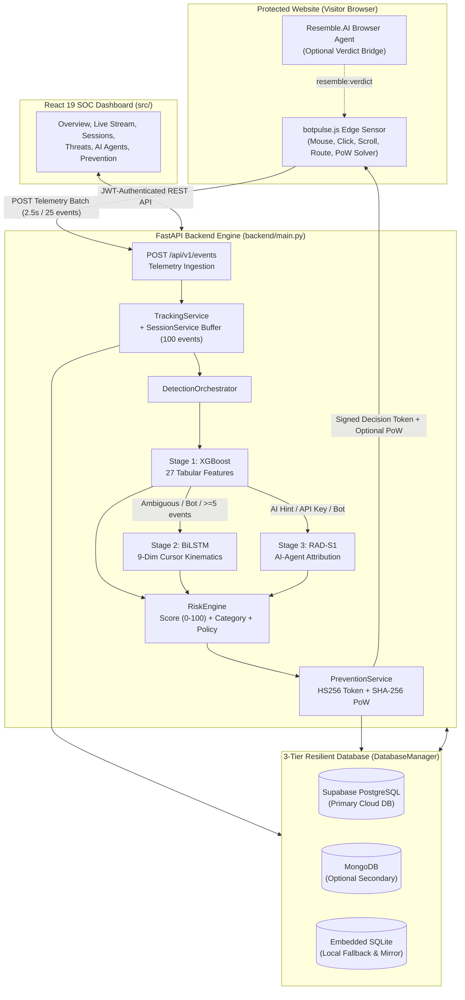
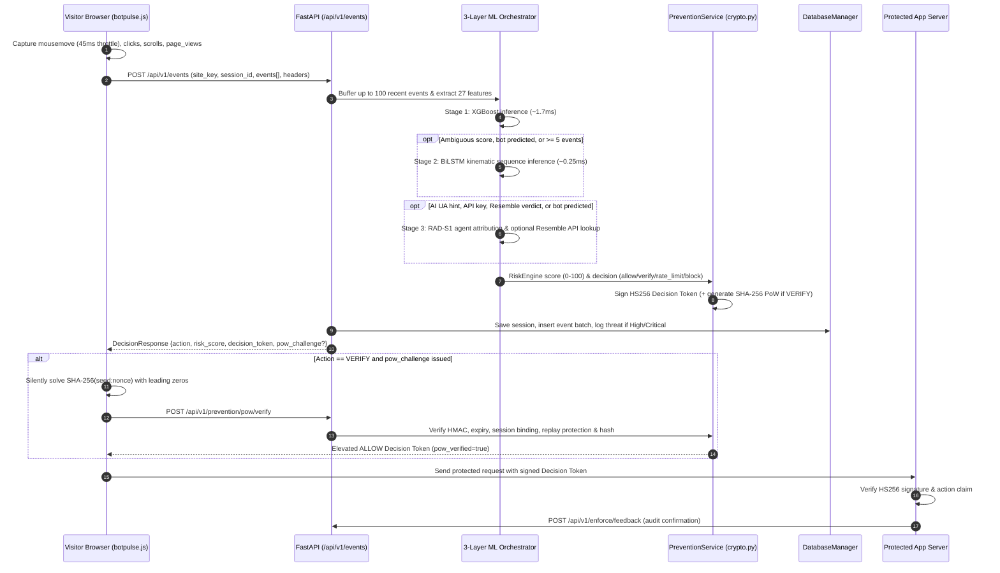

# 1. System Architecture & Data Flow

This guide explains how **BotPulse** works from end to end—how behavioral signals leave a visitor's browser, pass through the 3-layer AI detection pipeline, trigger cryptographic enforcement, and appear in real time on the Security Operations Center (SOC) dashboard.

---

## High-Level Architecture

BotPulse is built as a decoupled, event-driven security platform consisting of five main subsystems:

1. **Client Edge Sensor (`backend/sdk/botpulse.js`)** — A lightweight, zero-dependency JavaScript SDK embedded into protected websites (such as the reference storefront **ÉLVARA Fashion**). It captures micro-behavioral telemetry (cursor trajectories, touch gestures, clicks, scroll depth, SPA route transitions) and bridges optional Resemble.AI verdicts.
2. **FastAPI Security Engine (`backend/main.py`)** — The asynchronous REST API gateway that authenticates analysts, serves `botpulse.js`, ingests telemetry batches, manages site policies, and serves the compiled React SPA when deployed monolithically.
3. **3-Layer Hybrid ML Pipeline (`backend/ml/` & `backend/services/`)** — A conditional, staged inference cascade:
   - **Stage 1 (XGBoost):** Fast sub-millisecond tabular classifier over 27 session/HTTP features.
   - **Stage 2 (Bidirectional LSTM):** Deep PyTorch sequence model analyzing 9-dimensional cursor kinematics.
   - **Stage 3 (RAD-S1):** Multi-factor Autonomous AI-Agent Attribution engine (Gemini API keys, Resemble.AI verdicts, LLM crawler headers, goal-directed traversal).
4. **Unified Risk & Cryptographic Prevention Layer (`risk_engine.py`, `prevention_service.py`, `crypto.py`)** — Combines model outputs into an explainable 0–100 risk score, maps it to an enforcement action (`allow`, `verify`, `rate_limit`, `block`), signs an `HS256` Decision Token, and issues silent SHA-256 Proof-of-Work (PoW) challenges when needed.
5. **Resilient Storage & SOC Dashboard (`database.py`, `src/`)** — A 3-tier persistence layer (Supabase PostgreSQL → MongoDB → SQLite fallback) powering an 11-module React 19 + TypeScript SOC console.



---

## End-to-End Request Lifecycle

When a visitor lands on a protected website, the following sequence happens continuously in the background without interrupting legitimate users:



---

## Project Directory Map

Understanding where everything lives makes navigating and extending BotPulse straightforward:

```text
Botpulse/
├── app.py                        # Hugging Face Spaces entrypoint (mounts Gradio + FastAPI)
├── Dockerfile                    # Container image for unified backend + pre-built frontend
├── vercel.json                   # Vercel SPA hosting & reverse-proxy rewrites to backend
├── package.json                  # React 19 + TypeScript + Vite + Tailwind frontend config
├── requirements.txt              # Root Python dependencies (cloud deployment)
├── .env.example                  # Template for environment variables
├── start_tunnel.py / .bat        # Free Cloudflare Tunnel launcher for local backend exposure
│
├── backend/                      # Python FastAPI Security & ML Engine
│   ├── main.py                   # FastAPI app setup, CORS, router mounting, SPA static serving
│   ├── config.py                 # Pydantic Settings (secrets, DB URLs, Resemble.AI, defaults)
│   ├── database.py               # 3-tier DatabaseManager (Supabase PG → MongoDB → SQLite)
│   ├── requirements.txt          # Backend Python dependencies
│   ├── core/
│   │   ├── security.py           # bcrypt password hashing & HS256 user JWT utilities
│   │   └── crypto.py             # Decision Token signing & SHA-256 Proof-of-Work primitives
│   ├── ml/
│   │   ├── model_registry.py     # Singleton registry tracking all 3 ML layers + runtime stats
│   │   ├── feature_extractor.py  # 27-feature tabular extractor from raw telemetry batches
│   │   ├── xgboost_detector.py   # Stage 1: XGBoost classifier wrapper & rule correlation
│   │   ├── lstm_detector.py      # Stage 2: PyTorch BiLSTM classifier + kinematic fallback
│   │   ├── rad_s1_detector.py    # Stage 3: Autonomous AI-agent & Gemini/Resemble attribution
│   │   ├── train_lstm.py         # Offline PyTorch training script for Stage 2 BiLSTM
│   │   ├── evaluation_metrics.json    # Stage 1 test benchmark results (M4D + Web Robot)
│   │   └── feature_importances.json   # XGBoost feature importance weights
│   ├── models/                   # Serialized trained ML artifacts & schemas
│   │   ├── xgboost.joblib        # Trained Stage 1 XGBoost model
│   │   ├── preprocessor.joblib   # Trained Stage 1 StandardScaler
│   │   ├── lstm.pt               # Trained Stage 2 PyTorch BiLSTM weights
│   │   ├── lstm_scaler.joblib    # Trained Stage 2 RobustScaler for 9 kinematic features
│   │   ├── feature_schema.json   # Detailed metadata for all 27 tabular features
│   │   ├── training_config.json  # Training dataset split summary
│   │   └── lstm_training_report.json  # Stage 2 BiLSTM evaluation report
│   ├── routes/                   # FastAPI HTTP route handlers (/api/v1/*)
│   │   ├── auth.py               # /auth/register, /auth/login, /auth/me
│   │   ├── websites.py           # /websites CRUD & site key generation
│   │   ├── events.py             # /events ingestion & /events/test-agent simulator
│   │   ├── dashboard.py          # /dashboard/* analytics, live stream, sessions, threats
│   │   └── prevention.py         # Policies, PoW challenge/verify/stats, Resemble sync
│   ├── schemas/                  # Pydantic request/response validation models
│   ├── services/                 # Business logic & orchestration
│   │   ├── tracking_service.py   # Top-level telemetry pipeline coordinator
│   │   ├── session_service.py    # In-memory 100-event trajectory ring buffer
│   │   ├── detection_orchestrator.py  # Conditional 3-layer execution engine
│   │   ├── risk_engine.py        # Multi-layer verdict synthesis & policy mapping
│   │   ├── prevention_service.py # Decision tokens, PoW lifecycle & replay protection
│   │   └── resemble_client.py    # Server-side Resemble.AI RAD-S1 REST client
│   └── sdk/
│       └── botpulse.js           # Universal browser tracking & PoW SDK (v1.4.0)
│
├── src/                          # React 19 + TypeScript + Vite Frontend
│   ├── App.tsx                   # Public, Auth, and Protected SOC Dashboard routing
│   ├── services/api.ts           # Typed API client with dynamic base URL discovery
│   ├── contexts/                 # AuthContext (JWT session) & AppContext (global state)
│   ├── pages/
│   │   ├── marketing/            # 8 public product pages (Home, Platform, Docs, etc.)
│   │   ├── auth/                 # Login, Register, Onboarding, Reset Password flows
│   │   └── dashboard/            # 11 SOC modules (Overview, Live, Sessions, Threats, etc.)
│   └── components/               # Reusable charts, trajectory visualizer, modals, shaders
│
├── supabase/                     # Supabase PostgreSQL DDL & seed scripts
│   ├── schema.sql                # Full table, index, RLS policy & seed definitions
│   └── migrations/               # Timestamped SQL migrations
│
└── scripts/                      # Utility & reporting scripts
    └── migrate_to_supabase.py    # One-click local SQLite → Supabase PostgreSQL migration
```

---

## Next Reading

- **[2. 3-Layer Hybrid ML Detection Engine](./02-ml-detection-engine.md)** — How XGBoost, BiLSTM, RAD-S1, and the Risk Engine classify visitors.
- **[3. Browser SDK, Decision Tokens & Proof-of-Work](./03-sdk-and-prevention.md)** — How to integrate `botpulse.js` and enforce decisions.
