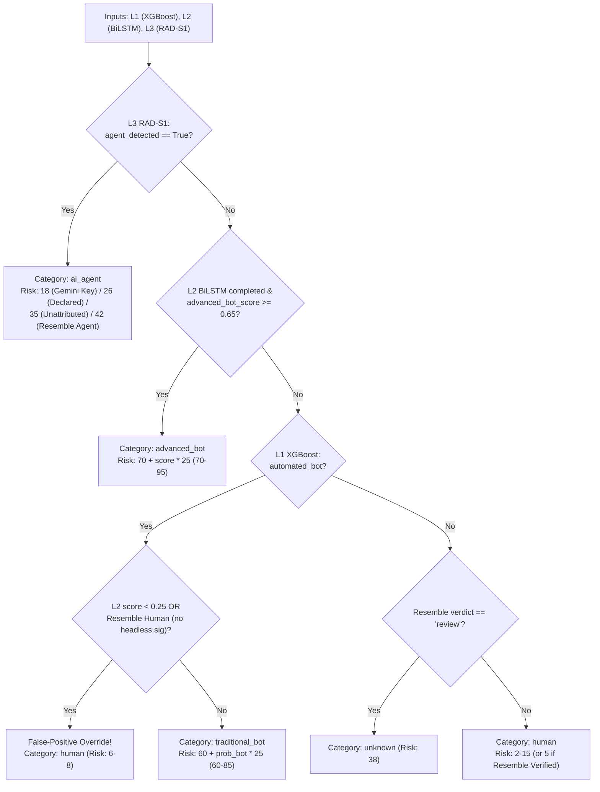

# 2. Three-Layer Hybrid ML Detection Engine

Traditional bot blockers rely on static IP blocklists or simple User-Agent checks, which either miss sophisticated headless browsers or falsely block legitimate AI shopping/search agents. **BotPulse** solves this with a **staged, conditional 3-layer ML architecture** coordinated by `DetectionOrchestrator` (`backend/services/detection_orchestrator.py`) and synthesized by `RiskEngine` (`backend/services/risk_engine.py`).

---

## Why Three Layers?

| Stage | Model / Engine | Input Data | Purpose | Typical Latency |
| :--- | :--- | :--- | :--- | :--- |
| **Stage 1** | **XGBoost** (`xgboost_detector.py`) | 27 tabular session & HTTP features | Fast screening to separate obvious humans from traditional scrapers & bursts | **1.73 ms** mean |
| **Stage 2** | **Bidirectional LSTM** (`lstm_detector.py`) | 9-dim cursor kinematic sequences (up to 60 steps) | Catch stealth/advanced bots with synthetic trajectories & prevent false positives on real humans | **0.25 ms** mean |
| **Stage 3** | **RAD-S1** (`rad_s1_detector.py`) | API keys, headers, Resemble.AI verdicts, goal-directed traversal | Distinguish authorized/autonomous **AI Agents** (Gemini, Claude, GPTBot) from malicious scrapers | **~2–3 ms** |

Because Stage 2 and Stage 3 run **conditionally**, clean human traffic is screened in under 2 milliseconds while ambiguous or high-risk sessions receive deep sequential and attribution analysis.

---

## Conditional Orchestration Rules

Inside `DetectionOrchestrator.orchestrate()`:

1. **Feature Extraction:** `extract_features_from_events()` builds the 27-feature tabular vector from the session's buffered events (up to the 100 most recent events stored in `SessionService`).
2. **Stage 1 (Always Runs):** `XGBoostDetector.predict(features)` evaluates the session and sets `requires_advanced_analysis = True` whenever `0.35 <= prob_bot <= 0.75` (ambiguous) **or** `pred_class == 1` (bot).
3. **Stage 2 (Conditional):** Runs if `l1_result["requires_advanced_analysis"]` is true **or** `len(events) >= 5`. Otherwise recorded in `audit_trail.skipped_layers` as `L1_CONFIDENT_HUMAN_TRAFFIC`.
4. **Stage 3 (Conditional):** Runs if:
   - The `User-Agent` contains AI/crawler hints (`gemini`, `google-genai`, `claude`, `gpt`, `perplexity`, `bot`, `crawler`, `agent`, `langchain`, etc.), **or**
   - An agent credential/verdict is present (`resemble_token`, `resemble_verdict`, `gemini_api_key`, `api_key`, `x-goog-api-key`, `x-gemini-api-key`), **or**
   - Stage 1 classified the session as `automated_bot`.

---

## Stage 1: XGBoost Tabular Classifier

- **Code:** `backend/ml/xgboost_detector.py`, `backend/ml/feature_extractor.py`
- **Artifacts:** `backend/models/xgboost.joblib` + `backend/models/preprocessor.joblib` (`StandardScaler`)
- **Training Data (`backend/models/training_config.json`):** Combined **67,642** labeled sessions (53,964 humans, 13,678 bots) from the **Web Robot Detection** dataset (67,352 sessions) and the **M4D** dataset (290 sessions / 305,377 raw requests), split into 54,110 training and 13,532 test observations.

### The 27 Input Features

Features are extracted in strict schema order (`COMMON_FEATURES` in `feature_extractor.py` and `backend/models/feature_schema.json`):

| Category | Features |
| :--- | :--- |
| **Volume & Pacing (5)** | `NUMBER_OF_REQUESTS`, `TOTAL_DURATION`, `AVERAGE_TIME`, `STANDARD_DEVIATION`, `REPEATED_REQUESTS` |
| **HTTP Status Ratios (4)** | `HTTP_RESPONSE_2XX`, `HTTP_RESPONSE_3XX`, `HTTP_RESPONSE_4XX`, `HTTP_RESPONSE_5XX` |
| **HTTP Method Ratios (4)** | `GET_METHOD`, `POST_METHOD`, `HEAD_METHOD`, `OTHER_METHOD` |
| **Temporal & Resource Mix (6)** | `NIGHT`, `IMAGES`, `TOTAL_HTML`, `HTML_TO_IMAGE`, `HTML_TO_CSS`, `HTML_TO_JS` |
| **Navigation & Traversal (8)** | `WIDTH`, `DEPTH`, `STD_DEPTH`, `CONSECUTIVE`, `DATA`, `SF_REFERRER`, `SF_FILETYPE`, `MAX_BARRAGE` |

**Top 5 Most Important Features (`backend/ml/feature_importances.json`):**
1. `MAX_BARRAGE` — **53.15%** (peak requests/events within rapid burst windows)
2. `SF_REFERRER` — **10.29%** (HTTP Referrer presence ratio)
3. `HTML_TO_CSS` — **6.79%** (ratio of HTML documents to CSS asset loads)
4. `NUMBER_OF_REQUESTS` — **5.07%** (total session request count)
5. `HTML_TO_IMAGE` — **3.17%** (ratio of HTML documents to image loads)

### Rule Correlation & Reason Codes

Alongside XGBoost probabilities, Stage 1 emits explainable reason codes:
- `HIGH_FREQUENCY_BURST` (`MAX_BARRAGE > 8`)
- `UNNATURAL_FIXED_CADENCE` (`STANDARD_DEVIATION < 0.05` and `NUMBER_OF_REQUESTS > 3`)
- `ZERO_CURVATURE_TRAJECTORY` (`CONSECUTIVE` straight-line ratio `> 0.85`)
- `HEADLESS_AUTOMATION_SIGNATURE` (`User-Agent` matches `headless`, `puppeteer`, `playwright`, `selenium`, `phantomjs`, `scrapy`, `curl`, `wget`, `python-requests`)

If strong headless/automation signals fire while `prob_bot < 0.60`, Stage 1 correlates them and elevates `prob_bot = 0.91` so downstream layers inspect the session.

### Stage 1 Benchmark Metrics (`backend/ml/evaluation_metrics.json`)

| Metric | Overall Test Set (13,532 sessions) | Web Robot Detection (13,471) | M4D (61) |
| :--- | :---: | :---: | :---: |
| **Accuracy** | **92.65%** | 92.68% | 86.89% |
| **ROC-AUC** | **0.9888** | 0.9889 | 0.9493 |
| **Macro F1** | **0.8971** | 0.8969 | 0.8578 |
| **Weighted F1** | **0.9299** | 0.9302 | 0.8663 |
| **Bot Recall** | **96.82%** | 96.85% | 94.59% |
| **Human Precision** | **99.13%** | 99.15% | 90.00% |
| **Mean Latency** | **1.73 ms** (P95: 2.27 ms) | — | — |

---

## Stage 2: Bidirectional LSTM Behavioral Sequencer

- **Code:** `backend/ml/lstm_detector.py` (inference), `backend/ml/train_lstm.py` (training)
- **Artifacts:** `backend/models/lstm.pt` + `backend/models/lstm_scaler.joblib` (`RobustScaler`)
- **Dataset (`backend/models/lstm_training_report.json`):** M4D Web Bot Detection Dataset (Phase 1 & Phase 2) — 499 labeled trajectory sessions (414 train / 85 test), sliding sequence window size = 30.

### Kinematic Feature Engineering (9 Features per Step)

Given consecutive interaction coordinates $(x_{i-1}, y_{i-1}, t_{i-1}) \to (x_i, y_i, t_i)$ over a rolling window of up to **60 events** (minimum **8 events** required), BotPulse computes a 9-dimensional vector for every movement step:

1. `dx` = $x_i - x_{i-1}$ (horizontal displacement)
2. `dy` = $y_i - y_{i-1}$ (vertical displacement)
3. `dt` = $\max(0.001, t_i - t_{i-1})$ (inter-event delta in seconds)
4. `dist` = $\sqrt{dx^2 + dy^2}$ (Euclidean step distance)
5. `speed` = $\min(\text{dist} / dt, 6000)$ (instantaneous velocity, px/s)
6. `accel` = $(\text{speed}_i - \text{speed}_{i-1}) / dt$ (acceleration, clamped to $\pm 10^5$)
7. `angle` = $\text{atan2}(dy, dx)$ (movement heading in radians)
8. `d_angle` = wrapped angular change in $[-\pi, \pi]$ (curvature/turning)
9. `jerk` = $(\text{accel}_i - \text{accel}_{i-1}) / dt$ (rate of change of acceleration, clamped to $\pm 10^6$)

Human hands exhibit natural micro-tremors, smooth acceleration/deceleration curves, and subtle curvature; scripted bots tend to move at unnaturally constant velocity (`SYNTHETIC_VELOCITY_UNIFORMITY`), in razor-straight lines (`UNNATURAL_LINEAR_TRAJECTORY`), or with sudden teleport jumps (`ERRATIC_STEP_DISCONTINUITY`).

### Neural Architecture (`BiLSTMBehavioralClassifier`)

```text
Input Tensor: [batch_size, seq_len, 9]  (scaled via RobustScaler)
      │
      ▼
2-Layer Bidirectional LSTM (hidden_dim=64 per direction → 128 dims, dropout=0.2)
      │
      ▼
Temporal Mean Pooling across sequence dimension → [batch_size, 128]
      │
      ▼
MLP Head: Linear(128 → 64) → ReLU → Dropout(0.2)
        → Linear(64 → 32)  → ReLU → Dropout(0.2)
        → Linear(32 → 1)   → Sigmoid → advanced_bot_score ∈ [0, 1]
```

### Graceful Fallback (No-PyTorch Environments)

If PyTorch is not installed in a lightweight serverless environment, `LSTMDetector` automatically falls back to kinematic heuristics based on `robotic_smoothness_index` ($1 / (1 + \sqrt{\text{Var(speed)}})$) and `angular_variance`, so the API never crashes.

### Stage 2 Benchmark Metrics (`backend/models/lstm_training_report.json`)

| Metric | Test Result |
| :--- | :---: |
| **Accuracy** | **99.91%** |
| **Precision** | **100.0%** |
| **Recall** | **99.88%** |
| **F1-Score** | **0.9994** |
| **ROC-AUC** | **1.0000** |
| **Mean Inference Latency** | **0.25 ms** |

---

## Stage 3: RAD-S1 Autonomous AI-Agent Attribution

- **Code:** `backend/ml/rad_s1_detector.py`, `backend/services/resemble_client.py`
- **Purpose:** Modern web traffic includes legitimate autonomous AI agents (like Google Gemini, Anthropic Claude, ChatGPT browsing, Perplexity) acting on behalf of users. Blocking them blindly hurts AI commerce and discovery, while letting unverified agents run unchecked creates abuse risks.

RAD-S1 evaluates six attribution signals:

1. **Google Gemini API Key Verification:** Inspects `gemini_api_key`, `api_key`, `x-goog-api-key`, `x-gemini-api-key`, `Authorization: Bearer ...`, or query parameters (`key`, `gemini_api_key`) for Google API key patterns (`AIza...` or explicit Gemini test keys). Authenticated Gemini agents receive `VALID_GEMINI_API_KEY` and `VERIFIED_AI_AGENT` with a low risk score (`18.0`).
2. **Declared Agent Family Signatures:** Matches `User-Agent` and `x-agent-family` headers against `KNOWN_AGENT_FAMILIES` (Google Gemini / DeepMind / LangChain-Google, Anthropic Claude, OpenAI GPTBot / ChatGPT-User / OAI-SearchBot, Perplexity, ByteSpider, Cohere, Diffbot).
3. **Resemble.AI Live Verdict & Server Verification:** Processes `resemble_verdict` (`agent`, `human`, or `review`) forwarded by `botpulse.js` and, if `RESEMBLE_API_TOKEN` is configured on the backend, authoritatively cross-checks the Resemble session ID (`sid`) server-side via `ResembleClient.fetch_session()` (with a 30-second cache).
4. **Goal-Directed Traversal (`GOAL_DIRECTED_TRAVERSAL`):** Flags linear e-commerce funnels (`Search → Product → Cart/Checkout`).
5. **Sub-Human Page Dwell (`SUB_HUMAN_PAGE_DWELL`):** Flags average inter-page dwell times between `0.1s` and `1.2s`.
6. **Programmatic DOM Dispatch (`PROGRAMMATIC_DOM_DISPATCH`):** Detects direct element-targeted clicks lacking natural approach deceleration.

---

## Unified Risk Engine & Decision Matrix

`RiskEngine.evaluate()` (`backend/services/risk_engine.py`) synthesizes all three layers using a strict priority order:



### Risk Tiers & Enforcement Actions

| Visitor Category | Risk Score Range | Risk Level | Default Decision | Resulting Behavior |
| :--- | :---: | :---: | :---: | :--- |
| `human` | `0.0 – 29.9` | `low` | **`allow`** | Seamless browsing; `ALLOW` signed token issued |
| `ai_agent` (Gemini Key / Declared) | `18.0 – 26.0` | `low` | **`allow`** | Recognized legitimate AI agent; `ALLOW` token issued |
| `ai_agent` (Unverified / Resemble) | `35.0 – 42.0` | `moderate` | **`verify`** | Triggers silent SHA-256 Proof-of-Work verification |
| `unknown` (Review / Ambiguous) | `38.0 – 54.9` | `unknown` / `moderate` | **`verify`** | Triggers silent SHA-256 Proof-of-Work verification |
| `traditional_bot` | `55.0 – 79.9` | `high` | **`rate_limit`** | Throttled at protected application edge |
| `traditional_bot` / `advanced_bot` | `80.0 – 100.0` | `critical` | **`block`** | Hard blocked (`403`); cannot bypass via PoW |

> **Important Security Design:** Notice the false-positive protection in `RiskEngine`—if Stage 1 XGBoost flags a session as a bot, but Stage 2 BiLSTM verifies natural biomechanical cursor kinematics (`advanced_bot_score < 0.25`), BotPulse overrides the tabular false positive back to `human` (`LSTM_VERIFIED_HUMAN_KINEMATICS`). Conversely, if a session is hard-blocked (`enforcement == "block"`), it can **never** upgrade itself by solving Proof-of-Work.
