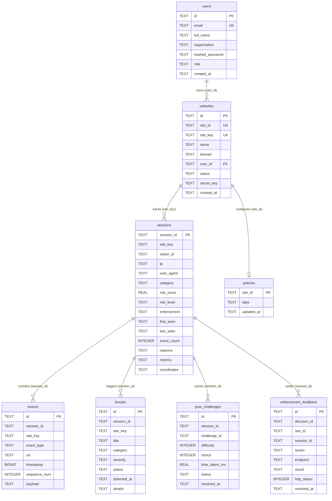

# 5. Database Architecture & SOC Dashboard Frontend

This guide covers how BotPulse persists security data reliably across cloud and local environments, and how the React 19 SOC Dashboard is structured.

---

## Part 1: 3-Tier Resilient Database Layer

Implemented in `backend/database.py` (`DatabaseManager`) with cloud DDL in `supabase/schema.sql`.

### Connection Failover Strategy

At startup, `DatabaseManager` evaluates backends in priority order so the engine works seamlessly both in production cloud deployments and zero-config local laptops:

1. **Tier 1 — Supabase Cloud PostgreSQL (Primary):**
   - Triggered when `SUPABASE_DB_URL` or `DATABASE_URL` contains `postgres`.
   - Performs a fast **0.8-second TCP socket pre-flight probe** before opening the `psycopg2.pool.ThreadedConnectionPool(minconn=2, maxconn=20)` so unreachable hosts never freeze startup.
   - Automatically enforces `sslmode=require`, TCP keepalives, retry logic on pool exhaustion, and an on-demand fallback to Supabase's transaction pooler port (`6543`).
2. **Tier 2 — MongoDB (Optional Secondary):**
   - Used if PostgreSQL is not configured and `MONGODB_URI` responds to `ping` within 300 ms.
3. **Tier 3 — Embedded SQLite (Local Fallback & Write Mirror):**
   - Stored at `backend/data/botpulse.db` (or `/tmp/botpulse.db` on read-only serverless environments like Vercel/Lambda).
   - **Write Mirroring:** Mutations executed against PostgreSQL are also mirrored locally to SQLite for resilience, and if a PostgreSQL query encounters a transient network outage, reads transparently fall back to SQLite.

### Entity-Relationship Diagram

### Database Tables Summary

| Table | Purpose | Key Indexes |
| :--- | :--- | :--- |
| `users` | SOC analyst accounts (bcrypt password hashes + roles). Seeds default analyst `analyst@botpulse.io`. | `email` (UNIQUE) |
| `websites` | Registered protected domains with `site_id`, public `site_key`, and `secret_key`. Seeds **ÉLVARA Fashion** (`site_alvera_001`). | `site_key`, `domain` |
| `sessions` | Evaluated visitor sessions storing ML category, risk score/level, enforcement action, JSON reason codes, kinematic metrics, and last 40 cursor `(x, y, t)` coordinates for 2D replay. | `(site_key, last_seen DESC)`, `category` |
| `events` | Raw behavioral telemetry events (`mouse_move`, `click`, `scroll`, `page_view`, `resemble_verdict`, `ecommerce_*`) with server-clamped UTC millisecond timestamps. | `(session_id, timestamp DESC)`, `(site_key, timestamp DESC)` |
| `threats` | Automatically generated SOC alerts whenever a non-human session reaches `high` or `critical` risk, with analyst triage status (`new`, `investigating`, `confirmed`, `resolved`, `false_positive`). | `(site_key, detected_at DESC)` |
| `enforcement_feedback` | Audit log of server-side decision enforcement confirmations reported by protected applications. | Primary key `id` |
| `pow_challenges` | Record of verified Proof-of-Work solutions (`challenge_id`, `difficulty`, `nonce`, `time_taken_ms`) providing persistent replay protection across restarts. | Primary key `id` |
| `policies` | Per-site JSON security policy (`PreventionPolicy`: risk cutoffs, RPM rate limits, PoW difficulty, headless/scraper rules, IP/ASN blocklists). | Primary key `site_id` |

---

## Part 2: React 19 + TypeScript SOC Frontend (`src/`)

### Tech Stack

- **Framework:** React 19 + TypeScript 5.7 + Vite 6
- **Routing:** `react-router-dom` v7 (`src/App.tsx`)
- **Styling & Animation:** Tailwind CSS 3.4, Framer Motion 12, Lucide React icons
- **State Management:**
  - `src/contexts/AuthContext.tsx` — Manages analyst JWT (`localStorage.bp_token`), login/register/logout, and `/auth/me` session verification.
  - `src/contexts/AppContext.tsx` — Manages active protected site selection, toast notifications, selected session modal state, and dashboard synchronization.

### Application Route Map

#### Public Marketing & Documentation Site (`PublicLayout`)
- `/` — `HomePage` (Hero, interactive neural pipeline shader, traffic visualizer)
- `/platform` & `/features` — `PlatformPage`
- `/solutions` — `SolutionsPage`
- `/technology` — `TechnologyPage` (Deep dive into XGBoost, BiLSTM, RAD-S1)
- `/pricing` — `PricingPage`
- `/docs` — `DocsPage` (In-app developer docs & SDK snippet)
- `/about` — `AboutPage`
- `/contact` — `ContactPage`

#### Authentication & Onboarding
- `/login`, `/register`, `/onboarding`, `/forgot-password`, `/reset-password`, `/verify-email`, `/unauthorized`, `/session-expired`

#### Authenticated SOC Dashboard (`/app/*` — Protected by `DashboardRouteWrapper`)

| Route | Page Component | What Analysts Can Do |
| :--- | :--- | :--- |
| `/app/overview` | `OverviewPage` | Executive KPIs (total requests, humans, bots, AI agents, mitigation rate), traffic trend chart, and 3-layer model health cards. |
| `/app/live` | `LiveMonitoringPage` | Real-time streaming feed of incoming behavioral telemetry events with live risk & enforcement badges. |
| `/app/analytics` | `TrafficAnalyticsPage` | Time-series traffic breakdowns, top targeted pages, and behavioral entropy/jitter comparisons. |
| `/app/sessions` | `SessionExplorerPage` | Searchable session table; clicking any session opens `SessionDetailModal` with 2D mouse trajectory replay and per-layer ML breakdown. |
| `/app/threats` | `ThreatIntelligencePage` | Incident triage queue for high/critical bot alerts with status updates (`investigating`, `confirmed`, `resolved`, `false_positive`). |
| `/app/agents` | `AIAgentActivityPage` | Dedicated view for autonomous AI agents (Google Gemini, Claude, GPTBot, Resemble.AI verified agents). |
| `/app/prevention` | `ThreatPreventionPage` | Configure site `PreventionPolicy` thresholds, adjust PoW difficulty (`2–5`), run live PoW browser benchmarks, and inspect enforcement feedback. |
| `/app/reports` | `ReportsPage` | Exportable security summaries and compliance/mitigation reporting. |
| `/app/integrations` | `IntegrationsPage` | Manage protected websites, generate new `site_key` tokens, copy the `botpulse.js` snippet, and check ÉLVARA Fashion / Resemble.AI status. |
| `/app/team` | `TeamManagementPage` | SOC analyst workspace roles and access management. |
| `/app/settings` | `SettingsPage` | Configure dynamic backend API URL overrides and workspace preferences. |

### Dynamic API URL Resolution (`src/services/api.ts`)

`getApiBaseUrl()` resolves the backend endpoint in the following precedence order:
1. Explicit URL query parameter `?api=https://...` (automatically persisted to `localStorage.bp_api_url` for 1-click tunnel switching).
2. Saved `localStorage.bp_api_url` (on HTTPS production hosts like Vercel, insecure `http://` or stale `trycloudflare.com` entries are automatically discarded to prevent Mixed Content errors).
3. On non-localhost production domains (e.g., Vercel), defaults to same-origin `/api/v1` (proxied cleanly via `vercel.json`).
4. On `localhost`, uses `VITE_API_URL` from `.env` (falling back to the default production API endpoint).
